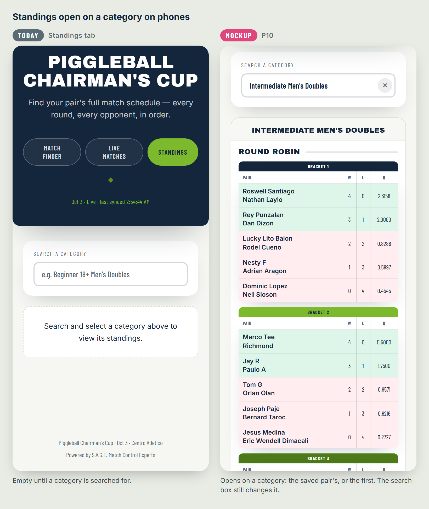
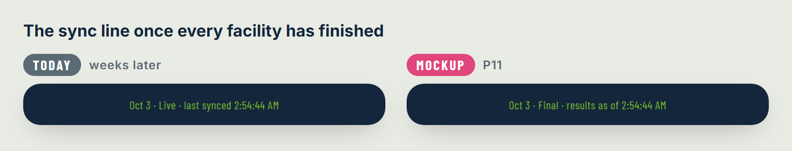
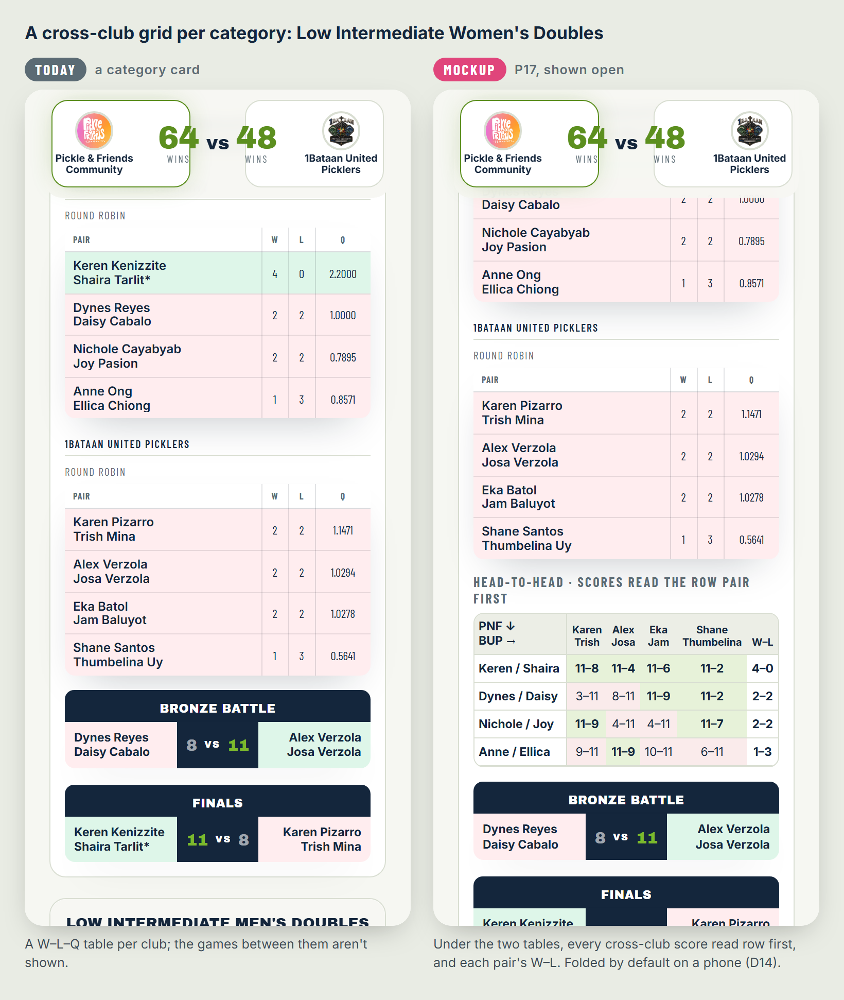

# Spec — Tournament Hub player experience

> **Status: not started — ready to build.** Written 2026-10-10 and 2026-10-25 as
> seventeen proposals; revisited 2026-11-23 against `sage-match-control.github.io`
> commit `b89fda5`, when the owner kept nine, dropped eight, had three redone and
> answered every decision (§12). Part 1 (§1–§12) is the build, written to be
> followed without any other context. Part 2 (§13–§16) is the background: why,
> the measurements, and what was considered and dropped.

Make the two things a player opens the [Tournament Hub](../../features/tournament-hub.md)
for, *where and when do I play next?* and *where do we stand?*, quicker on a phone.
The Hub keeps its three tabs (four at a team event); nothing moves off the page.

---

# Part 1. The build

## 1. What gets built

Eight steps, each one push to the site's `main`, in this order. Step 3 is two
proposals that share one bar.

| Step | Proposal | What a player sees | Control Center | Computers | Section |
| --- | --- | --- | --- | --- | --- |
| 1 | P1 | A search scrolls to its results and closes the keyboard and the suggestions | **Find matches** closes its suggestions; nothing scrolls | **Find matches** closes its suggestions; nothing scrolls | §3 |
| 2 | P3 | The pair summary card opens with the pair's next match | Yes: the card is shared | Yes | §4 |
| 3 | P2 + P5 | Once the banner scrolls away, a slim bar stays at the top with the tabs, the day and the sync line: in a ☰ menu on a phone | No | Yes: the same in a row on the right, no menu | §5 |
| 4 | P6 | Each round-robin table's header says *In progress · 6/10* or *Final*, and tied rows say how the tie was broken | Yes, team events included | Yes | §6 |
| 5 | P14 | Tapping a Standings row opens that pair in Match Finder | No | Yes | §7 |
| 6 | P12 | A finished category's Standings card opens with its podium | No: it has its Awards tab | Yes | §8 |
| 7 | P15 | A dual meet's Match Finder opens with the club score, and counts *Pairs*, not *Teams* | The *Pairs* label only | Yes | §9 |
| 8 | P16 | A dual meet's Standings on a phone have chips that jump to a category | No | No: phones only | §10 |

Proposal numbers (P1…P17) are the ones the owner marked; the dropped ones are in
§15. Build nothing from §15.

## 2. Before you start

### 2.1 Where things are

The workspace is `D:\Personal\SAGE`. Two repositories matter:

- **`sage-match-control.github.io/`**, the site. Static HTML and native ES
  modules, no build step, no framework, served by GitHub Pages from `main`. The
  Hub's code is the **engine**, `lib/v1/`:
  - `lib/v1/apps/hub.js`: `mountHub`, the Hub page's wiring.
  - `lib/v1/views/`: markup builders and small components (`finder.js`,
    `pair-summary.js`, `standings.js`, `teams.js`, `ticket.js`…).
  - `lib/v1/domain/`: the rules, pure functions with no DOM (`standings.js`,
    `awards.js`, `series.js`, `codes.js`, `matches.js`…).
  - `lib/v1/css/`: one stylesheet per view (`hub.css`, `finder.css`,
    `standings.css`, `teams.css`, `ticket.css`).
  - `_templates/<type>-template/index.html`: the three Hub templates (standard,
    dual meet, team). Each is a shell: markup, a `THEME` block of colours, and a
    call to `mountHub`.
  - `tools/control-center.html`: Control Center, the operators' console. It
    shares `finder.js`, `pair-summary.js`, `standings.js`, `teams.js` and
    `ticket.js` with the Hub, but not `apps/hub.js` or `hub.css`.
  - `_tests/`: the unit tests and the comparison harness (§2.4).
- **`sage-docs/`**, the documentation, a mkdocs site. This spec is
  `sage-docs/docs/specs/not-started/hub-player-experience-spec.md`.

Read `sage-match-control.github.io/_templates/CLAUDE.md` §8 and
`sage-docs/docs/technical/site-engine.md` (*Dependency rules*, *The versioning
rule*, *Extension points*, *The comparison harness*) before step 1.

### 2.2 The rules every step follows

1. **Only `lib/v1/` is edited, and only compatibly.** Add modules, exports,
   options and CSS classes. Never remove or rename an export, a CSS class a page
   uses, or a theme property, and never change an existing export's parameters
   or return shape. `lib/v1/` already serves live event pages (§2.5).
2. **New code goes in new modules.** A browser may keep any file of the site for
   up to ten minutes, so a module that starts using a new export of an *existing*
   module can meet a cached copy without it and fail. A brand-new module can't be
   cached, so importing it is always safe. Every step below puts its new
   functions in a new module for that reason, and is one push. Where a step adds
   an *option* to an existing function or component, an old cached copy just
   ignores it; that is safe too.
3. **Imports point one way** (`_tests/unit/guards.test.mjs` enforces it):
   `domain/` imports only `domain/`; `views/` imports `domain/` and `views/`;
   `apps/` imports anything but another app. No browser globals in `domain/`.
4. **Control Center changes only where a step says so.** Hub-only behaviour is an
   option the Hub passes, off by default.
5. **Colours come from the theme tokens** every shell defines (`--navy`,
   `--navy-deep`, `--green`, `--green-dark`, `--paper`, `--paper-dim`, `--line`,
   `--ink`, `--ink-soft`, `--white`, `--muted`; the full list is
   `_tests/unit/theme-contract.test.mjs`). A literal colour is used only where this
   spec gives one (the medal and *Tied* colours, which match existing pills).
6. **"A phone" means below 900 px wide**: the width at which `css/finder.css`
   already pins the search box (`@media (max-width:899px)`). Use
   `matchMedia('(max-width: 899px)')` in JavaScript and the same media query in
   CSS.
7. **Escape everything** put into markup with `escapeHtml` from `views/html.js`.

### 2.3 The branch, and who pushes

```bash
cd D:/Personal/SAGE/sage-match-control.github.io
git switch main && git pull
git switch -c hub-step-1        # hub-step-2, … one branch per step
```

Commit on the branch. **Merging into `main` and pushing is the owner's call: ask
before doing either.** Never merge within three days of an event: check the day
dates in `D:/Personal/SAGE/event-data/config/events.json` first. End every commit
message with the attribution line the session asks for.

### 2.4 The tests

```bash
cd D:/Personal/SAGE/sage-match-control.github.io/_tests
npm install                 # once
npm test                    # unit tests (_tests/unit/**), plain Node, no browser
npm run compare             # the comparison harness (Playwright)
npm run verify              # both; run it before asking to merge
CASE='^std-index/pickle-for-sight-2026/finder' npm run compare   # only some cases
```

- **Unit tests** cover pure functions and markup builders, on hand-made or fixture
  models. They run in Node with no DOM. `_tests/unit/views/standings.test.mjs`
  stubs `globalThis.window = { matchMedia: () => ({ matches: true }) }` where a
  builder asks for the screen size; do the same. Fixture models come from
  `_tests/helpers/fixtures.mjs`: `buildDayModel(eventConfig(ev),
  eventConfig(ev).days[0], loadSnapshot(ev), { now: caseTime(ev) })`, and
  `deriveState(snapshot, 'mid' | 'pre')` for the mid-day and pre-day states. The
  fixture events are `piggleball-2026` and `pickle-for-sight-2026` (standard),
  `pnf-x-bup-dual-meet` (dual meet), `pickledrive-anniversary-2026` and
  `team-demo-2026` (team).
- **The comparison harness** opens every page of `_tests/engine/cases.mjs` (case
  ids like `std-index/pickle-for-sight-2026/finder-search/mid/phone`; page labels
  `std-index`, `dm-index`, `team-index`, `cc`, `cc-signed-in`) in two trees, the
  merge-base with `main` and your branch, and compares the page's text and a
  full-page screenshot. It only finds differences when you work on a branch. A
  difference you intend is listed in `_tests/engine/accepted.mjs` as
  `{ case: /<regex over case ids>/, kind: 'text' | 'pixels' | 'both', row: 'owner 2026-11-23 hub P<n>', reason: '<what changed>' }`.
  Add an entry only for cases that actually differ, scoped as narrowly as the
  failures, and only for the change the step describes.
- **Behaviour tests.** The harness's screenshots are full-page: the viewport
  grows to the page's height, so nothing is ever scrolled and the banner is
  always in view. Scrolling, the bar and the menu (steps 1, 3, 5, 8) are checked
  instead by a new test file, `_tests/engine/hub-behaviour.test.mjs`, which
  `npm run compare` runs with the rest of `engine/`. It opens a harness case at a
  real 375 × 812 viewport and asserts on the live page:

  ```js
  import { describe, it, before, after } from 'node:test';
  import assert from 'node:assert/strict';
  import { SITE_ROOT } from '../helpers/paths.mjs';
  import { launchBrowser, openPage, settle } from '../helpers/browser.mjs';
  import { startSite } from '../helpers/server.mjs';
  import { buildCases } from './cases.mjs';

  const cases = buildCases();
  /** Open a harness case; with runSteps, also run its steps (open a tab, pick a category…). */
  async function openCase(browser, site, id, { runSteps = false } = {}) {
    const c = cases.find(x => x.id === id);
    site.register(c.id, c.instantiate);
    const h = await openPage(browser, site.baseUrl + c.path, {
      viewport: c.viewport, time: c.time, registry: c.registry, snapshots: c.snapshots,
      fixtureFiles: c.fixtureFiles, external: c.external, cloudRun: c.cloudRun,
      allowErrors: c.allowErrors, storage: c.storage, caseId: c.id,
    });
    await settle(h.page);
    if (runSteps) for (const s of c.steps) { await s.run(h.page, h); await settle(h.page); }
    return h;
  }

  describe('the Hub on a phone', () => {
    let browser, site;
    before(async () => { browser = await launchBrowser(); site = await startSite({ root: SITE_ROOT }); });
    after(async () => { await browser.close(); await site.close(); });
    // it(...) per behaviour, each opening its own page with openCase and closing it in finally.
  });
  ```

  The harness's pages run with *reduce motion* on, so every scroll is instant.

### 2.5 The live pages the engine already serves

Four event pages import `lib/v1/` and change the moment a step reaches `main`:
`events/acso-sportsfest-2026/`, `events/upap-2026/`,
`events/archives/ladies-dink-2026/` and `events/archives/millennium-invitational-2026/`.
The harness covers only the templates, and these shells have their own hero
markup (UPAP's date line has a `<br>`; its title has spans). Before asking to
merge, open each at 375 × 812 (the browser's device toolbar) and check the
step's change looks right and nothing else moved. They read the real published
results over the internet. To serve the repo:

```bash
cd D:/Personal/SAGE/sage-match-control.github.io
node -e "import('./_tests/helpers/server.mjs').then(async ({ startSite }) => { const s = await startSite({ root: '.' }); console.log(s.baseUrl + '/events/upap-2026/'); })"
```

### 2.6 The docs, with every step

In `sage-docs`, in the same change as the step's merge (§11 lists the pages):
describe what the Hub does now, in the present tense; bump the version (a new
`## [x.y.z] — YYYY-MM-DD` entry at the top of `docs/changelog.md`, the same
version in `mkdocs.yml`'s `copyright` line; a feature change is a MINOR bump). On
the first step merged, move this spec to `docs/specs/in-progress/` and after the
last to `docs/specs/implemented/`, following the procedure in
`docs/specs/README.md`. Where the build departs from this spec, add a
*Divergences* section at the end of Part 1 saying what and why.

### 2.7 The pictures

Each step's picture is a mockup: the real template page on fixture data at 1 PM,
375 × 812, with the new elements drawn in by hand. It shows what goes where and
roughly how it looks; the sizes and colours written in the step win where the two
differ. In the mid-day pictures the card's playoff rows are left out and the
Standings tables show the finished day's W and L: the fixtures' mid-day state
blanks scores but keeps the finished day's names and standings, which a real
mid-day workbook would not have.

## 3. Step 1 — P1: show the results after a search

**Today.** On a phone a search changes nothing on the first screen: the results
start at 763 px on an 812 px screen, under the banner and the search box
(§13.1). **Find matches** leaves the suggestion list open over the results
(`createFinder` closes it only on a click *outside* `.autocomplete`, and the
button is inside), and the keyboard stays up. A team event's team chip scrolls to
the top of the page.

**After.** When a person runs a search, on a phone, the suggestions close, the
keyboard closes, and the page scrolls so the results start just under the pinned
search box. On a computer nothing scrolls. A data refresh (every push or poll)
and clearing the box never scroll.

![Match Finder on a phone after searching for Josh Manarang / Angelo Manarang at Pickle for Sight, 1 PM. Today, first screen: the banner and the search box fill it and the results start below. Today, scrolled down: the pair summary card (Novice Men's Doubles, Bracket 2, #2 of 5, W 3, L 1, PF 20, PA 12, Q 3.0000), then the tickets. Mockup: the page has scrolled to the results, and the card opens with a navy Next match block reading 2:50 PM · Court 4, vs Tony Hecker / Angelo Culala · PCPH Main, Round robin · Match 1060.](../../images/hub-player-experience/p1-p3-search.png)

The right-hand panel is steps 1 and 2 together.

**Build.**

1. **New module `lib/v1/views/reveal.js`**, exporting:
   - `PHONE_QUERY = '(max-width: 899px)'`.
   - `revealResults({ resultsEl, searchPanelEl, input })`, returning `true` when it
     scrolled and `false` when it did nothing. It does nothing unless
     `matchMedia(PHONE_QUERY).matches`. Otherwise: `input.blur()`; then
     `stuck = (parseFloat(getComputedStyle(searchPanelEl).top) || 0) + searchPanelEl.getBoundingClientRect().height + 8`;
     `top = resultsEl.getBoundingClientRect().top + window.scrollY - stuck`;
     `window.scrollTo({ top: Math.max(0, top), behavior: matchMedia('(prefers-reduced-motion: reduce)').matches ? 'auto' : 'smooth' })`.
     (`searchPanelEl` is `position: sticky; top: 8px` on a phone, so `stuck` is
     the space it takes once pinned.)
2. **`views/finder.js`, `createFinder`**: a new option `onSearched` (default
   `() => {}`), called right after `finder.run()` in exactly three handlers: a
   click on a suggestion (`acList` click), Enter in the box, and the **Find
   matches** button. In the **Find matches** handler, also
   `acList.classList.remove('show')` before `finder.run()`; that one is a fix and
   reaches Control Center too. `refresh`, `rebuildIndex`, `setQuery`, `reset` and
   the clear button never call `onSearched`. Document the option in the comment
   above `createFinder`.
3. **`views/teams.js`, `createTeams`**: a new option `onSearched`, a function
   returning `true` when it moved the page. In the team chip handler
   (`.team-chip-btn`), after `finder.run()`: call `options.onSearched` when it is
   set, and keep today's `window.scrollTo({ top: 0, … })` when it is not set or
   returned `false`. So a computer, where `revealResults` does nothing, and Control
   Center keep scrolling to the top as today. Document it with the other options.
4. **`apps/hub.js`**: `const reveal = () => revealResults({ resultsEl, searchPanelEl, input });`
   and pass `onSearched: reveal` to both `createFinder` and `createTeams`.
   (`createFinder` ignores the return value.)
5. **A returning visit (decision D3).** In `selectDay`'s `isInitialLoad` branch,
   after `finder.setQuery(savedSearch)`, call `reveal()` when the Match Finder tab
   is the active one (`document.querySelector('.view-tab[data-view="finder"].active')`).

**Tests.**

- `hub-behaviour.test.mjs` (§2.4), on `std-index/pickle-for-sight-2026/finder/mid/phone`:
  type `Josh` into `#teamInput`, click the first `#acList .ac-item`, then assert
  `#results`'s `getBoundingClientRect().top` is between 0 and 300,
  `document.activeElement` is not `#teamInput`, and `#acList` lacks `show`. Again
  with **Find matches** (`#searchBtn`) after typing `Josh Manarang`. The same on
  `…/desktop` asserts `window.scrollY` is unchanged. On
  `team-index/pickledrive-anniversary-2026/finder/mid/phone`, click the first
  `.team-chip-btn` and assert `#results` is near the top as above; on its
  `…/desktop` twin, scroll down 400 px first, click the chip, and assert
  `window.scrollY` is 0 (today's behaviour, kept).
- The harness: add a view `finder-find-button` to the default views in
  `hubCases` (`_tests/engine/cases.mjs`):
  `[type('#teamInput', word), click('#searchBtn')]`. On the baseline its
  suggestions stay open; accept that difference.
- Manual: §2.5's four pages, a search on each.

**Done when** the behaviour tests pass, `npm run verify` passes with only the
accepted differences above, and the four live pages behave.

## 4. Step 2 — P3: the next match on the pair summary card

**Today.** Match Finder's pair summary card (`views/pair-summary.js`, drawn by
`pairResultsHTML` in `views/finder.js` above a searched pair's tickets) shows the
pair's category, bracket, round-robin rank, W, L, PF, PA, Q, a row per playoff
round reached, and a status pill. For a pair in the playoffs its round rows
already give the next match. During the round robin, most of the day, nothing on
the card says when the pair plays next: only a small **Next Up** pill on one
ticket further down. A round-robin match on court shows no *Playing now*. Before
the day goes live the card is not drawn at all.

**After.** The card opens with a navy block that answers *where and when do I play
next?* (the right-hand panel of the picture in §3).

| State | When | The block |
| --- | --- | --- |
| Playing now | The day is live and one of the pair's matches has a live court (`m.liveCourt`) and is not played | **Playing now** (with the live dot) · **Court 3** · *vs* opponent · round · match number |
| Next match | Otherwise, the pair's **Next Up** match (the rule below) | **Next match** · **2:50 PM · Court 4** · *vs* opponent · round · match number |
| Nothing left | No match is live or next | No block |

**Build.**

1. **New module `lib/v1/domain/pair-schedule.js`**, the order and the Next Up rule
   moved out of `pairResultsHTML` unchanged:
   - `pairMatches(model, codes)`: `model.matches` where `codes` includes `m.t1` or
     `m.t2` and `matchByeSide(m) === null` (`domain/byes.js`), sorted by
     `eventScheduleMinutes(m.time)` (`domain/progress.js`; `null` sorts last as
     `Infinity`), then by `m.num`.
   - `nextUpIndex(model, list)`: the index of the first `m` in `list` with
     `!m.played && !m.liveCourt && !model.unneededGames.has(m)`, or `-1`.
2. **`views/finder.js`, `pairResultsHTML`**: use the two functions instead of its
   own sort and `findIndex`. Nothing it draws changes; the existing tests in
   `_tests/unit/views/finder.test.mjs` must pass unchanged.
3. **`views/pair-summary.js`**: a new export `nextMatchHTML(team, model)` (`team`
   is a pair of `buildPairIndex`: `{ codes, p1, p2, label }`):
   - `list = pairMatches(model, team.codes).filter(m => !model.unneededGames.has(m))`.
   - `live = model.isLive ? list.find(m => m.liveCourt && !m.played) : null`;
     otherwise `next = list[nextUpIndex(model, list)]`. Neither: return `''`.
   - The pair's side is side 1 when `team.codes.includes(m.t1)`. The opponent is
     the other side: `"<p1> / <p2>"`, or, when that side is open (the file's own
     `sideIsOpen(code, p1)`), `openSeatLabel(code, model) || 'To be decided'`.
   - The round: `roundKeyword(parseCode(<the pair's code in m>, type).rest)` mapped
     through the file's `ROUND_NAME` (`Semifinal`, `Final`, `Bronze`…), or
     `Round robin` when it is `null`; a series game (`seriesGameOf(code)` not
     `null`) adds ` · Game <n>`.
   - The facility, only when `model.day.facilities.length > 1`: `m.facility`.
   - Markup (every value escaped):

     ```html
     <div class="ps-next ps-next--live">               <!-- or ps-next--next -->
       <small><span class="live-dot"></span>Playing now</small>   <!-- or: Next match (no dot) -->
       <b>Court 3</b>                                   <!-- next: "2:50 PM · Court 4"; leave out " · Court…" when m.court is blank -->
       <span>vs Tony Hecker / Angelo Culala<i> · PCPH Main</i></span>   <!-- the <i> only with a facility -->
       <em>Round robin · Match 1060</em>
     </div>
     ```

     Live court text is `Court ${m.liveCourt}`; the next match's is `m.time`, then
     ` · ${m.court}` (the scheduled `CourtAssignment`, already "Court 4").
4. **`pairSummaryHTML`**: a team event still returns `''` (decision D2: team
   events later). When the day is not live, or the pair has no round-robin row,
   return `<div class="pair-summary">${nextMatchHTML(team, model)}</div>`, or `''`
   when the block is empty (decision D15). Otherwise insert `nextMatchHTML(team, model)`
   as the card's first child, before `.ps-top`. Control Center draws the same card
   and gets the block too (decision D16).
5. **`css/finder.css`**, after the `.ps-*` rules:
   `.ps-next{background:var(--navy); color:var(--white); border-radius:12px; padding:12px 14px; margin:0 0 12px;}`;
   `.ps-next small` Barlow Condensed 700, 12px, letter-spacing .12em, uppercase,
   `color:var(--green)`, `display:flex; align-items:center; gap:6px`;
   `.ps-next b` block, Archivo Black 400, 24px, line-height 1.15, margin 3px 0 4px;
   `.ps-next span` block, 14px, line-height 1.35; `.ps-next span i` normal style,
   opacity .7; `.ps-next em` inline-block, normal style, margin-top 7px, Barlow
   Condensed 700 12px, letter-spacing .08em, uppercase,
   `background:rgba(255,255,255,.14)`, radius 999px, padding 3px 9px. The live dot
   is the existing `.live-dot`; on navy give it `background:var(--white)` as
   `.ps-status--live .live-dot` does.

**Tests.** `_tests/unit/domain/pair-schedule.test.mjs` (new): schedule order over
the match number, a BYE left out, Next Up skipping a live and an unneeded series
game. `_tests/unit/views/pair-summary.test.mjs`, on its hand-made days: the next
round-robin match; *Playing now* with a live court; an open playoff seat reading
its label; nothing left gives no block; a day not live gives the block alone; a
team event gives `''`. The harness: every `finder-search` case of `std-index`,
`dm-index` and `cc` differs (accept `both`).

**Done when** those pass, `npm run verify` passes with the accepted differences,
and §2.5's pages show the block after a search.

## 5. Step 3 — P2 + P5: a banner that folds into a bar

**Today.** The banner (logos, tagline, date and venue, title, headline, tabs, sync
line) fills the first 541 px of a phone and about 500 px of a computer. Scrolled
away, it takes the event's name, the tabs, the day picker and the sync line with it:
switching tab means scrolling back to the top.

**After.** At the top of the page the banner is unchanged. Once it has scrolled out
of view, a slim navy bar is pinned to the top of the screen, on every screen size:
the event's logo, its date and venue line in small green capitals and its title on
the left. What is on the right depends on the width:

- **On a phone** (below 900 px), a button naming the open tab (*Match Finder ☰*). It
  opens a menu over a dimmed page: the tabs (the open one marked), the day picker at
  a multi-day event, and the sync line.
- **On a computer** (900 px and wider), the same three in a row, right-aligned, with
  no menu: the sync line in small type, the day picker at a multi-day event, then the
  tabs as pills, the open one green (decision D19). Below 1100 px the sync line is
  left out, to leave room.

The bar goes away when the banner scrolls back into view. On a computer the QR panel
(fixed in the top-right corner) moves down under the bar while it shows (D20), and
Match Finder's search box scrolls away with the page as today: only a phone pins it
(D21). The bottom tab bar first proposed for P5 is not built.


**Build.**

1. **New module `lib/v1/views/hub-bar.js`**, exporting `HUB_BAR_HEIGHT = 54` and
   `createHubBar(options)`:
   - Options: `heroEl` (`header.hero`), `tabsWrapEl` (`#viewTabsWrap`),
     `dayPickerEl` (`#dayPicker`), `dayPickerWrapEl` (`#dayPickerWrap`),
     `syncStatusEl` (`#syncStatus`), `panelFor(view)` (the element to scroll to
     after a tab switch).
   - It appends to `document.body`, once:

     ```html
     <div class="hub-bar" hidden>
               <!-- the first .hero-logos img's src; left out when there is none -->
       <div class="hub-bar-text">
         <small class="hub-bar-meta">Sep 27 · PCPH Main</small>
         <span class="hub-bar-title">Pickle for Sight</span>
       </div>
       <div class="hub-bar-row">                         <!-- a computer's row; filled by update() -->
         <span class="hub-bar-sync">Sep 27 · Live · last synced 7:50:29 PM</span>
         <label class="hub-bar-day">Day <select>…</select></label>   <!-- only at a multi-day event -->
         <button type="button" class="hub-bar-tab active" data-view="finder">Match Finder</button>
         <button type="button" class="hub-bar-tab" data-view="live">Live Matches</button>
         <button type="button" class="hub-bar-tab" data-view="standings">Standings</button>
       </div>
       <button type="button" class="hub-bar-btn" aria-expanded="false" aria-controls="hubMenu">   <!-- a phone's menu button -->
         <span class="hub-bar-btn-label">Match Finder</span><span class="hub-bar-burger" aria-hidden="true"></span>
       </button>
     </div>
     <div class="hub-menu-scrim" hidden></div>
     <nav class="hub-menu" id="hubMenu" aria-label="Tournament Hub" hidden></nav>
     ```

     Both the row and the button are in the markup; the CSS shows one per width.
     The meta line is `heroEl.querySelector('.eyebrow')`'s `innerText`, the title
     `.title`'s `innerText`, each with `.replace(/\s+/g, ' ').trim()` (`innerText`,
     so a `<br>` becomes a space). A missing element leaves its line empty.
   - **The items**, the same on both widths and built by one function each time
     they are drawn: one tab per `.view-tab` that is showing (`style.display !== 'none'`
     and not `hidden`), `active` on the open one; the day picker when
     `dayPickerWrapEl.style.display !== 'none'`, a `<select>` with `dayPickerEl`'s
     options (leave out its disabled placeholder) and its value; the sync line,
     `syncStatusEl.textContent`, when `syncStatusEl` is showing.
   - **A tab** (in the row or the menu) closes the menu if it is open, clicks the
     matching `.view-tab` (whose handler switches the view and remembers it), then
     scrolls `panelFor(view)` to just under the bar (`top - HUB_BAR_HEIGHT - 8`,
     instant under *reduce motion*). **The day select** closes the menu, sets
     `dayPickerEl.value`, dispatches a `change` event on `dayPickerEl` and scrolls to
     the top.
   - **When the bar shows.** All three: the tabs are showing
     (`tabsWrapEl.style.display !== 'none'`); the hero is out of view (an
     `IntersectionObserver` on `heroEl`, threshold 0, keeps the last
     `isIntersecting`); and the stylesheet has loaded
     (`getComputedStyle(bar).position === 'fixed'`, so a cached old `hub.css` never
     shows an unstyled bar). Re-check on the observer's callback and on every
     `update()`. Showing sets `bar.hidden = false` and adds `hub-bar-on` to
     `document.body`; hiding reverses both and closes the menu.
   - **The menu** (a phone). The button toggles it. Opening fills `#hubMenu` with the
     items: `<button type="button" class="hub-menu-tab">` per tab, then
     `<label class="hub-menu-day">Day <select>…</select></label>`, then
     `<div class="hub-menu-sync">`. It unhides the scrim and the menu, sets
     `aria-expanded="true"` and focuses the first tab. The scrim, the button and
     Escape close it, which returns focus to the button. When the screen widens to
     900 px or more (`matchMedia(PHONE_QUERY)`'s `change` event; import
     `PHONE_QUERY` from `./reveal.js`) an open menu closes.
   - Returns `{ update() }`: redraws the row's items and the button's label (the open
     tab's text), and re-checks when the bar shows.
2. **`apps/hub.js`**: create the bar after the elements are looked up, with
   `panelFor: v => ({ finder: searchPanelEl, live: liveResultsEl, standings: standingsResultsEl, teams: teamsResultsEl })[v]`.
   Call `bar.update()` at the end of `showView`, at the end of
   `revealLiveTabsAfterLoad`, in `selectDay` after it hides the tabs, and in
   `loadLiveData` after it writes the sync line (both the success and the error
   branch).
3. **`views/reveal.js`** (step 1): when `document.body.classList.contains('hub-bar-on')`
   is false but a `.hub-bar` exists, the bar is about to appear as the page
   scrolls, so add the bar's 54 px to `stuck`. Define the number locally rather
   than importing it, so the two modules stay independent.
4. **`css/hub.css`**, appended:
   - Every width:
     - `.hub-bar{ position:fixed; top:0; left:0; right:0; z-index:50; height:54px; display:flex; align-items:center; gap:10px; padding:0 12px; background:var(--navy); color:var(--white); box-shadow:0 4px 14px rgba(0,0,0,.18); }`
       and `.hub-bar[hidden]{ display:none; }` (a `display:flex` rule overrides the
       `hidden` attribute otherwise).
     - `.hub-bar-logo{ width:32px; height:32px; border-radius:8px; background:var(--white); object-fit:contain; flex:none; }`
     - `.hub-bar-text{ flex:1; min-width:0; }`; `.hub-bar-meta` and
       `.hub-bar-title`: `display:block; white-space:nowrap; overflow:hidden; text-overflow:ellipsis;`.
       Meta: Barlow Condensed 700, 11px, letter-spacing .12em, uppercase,
       `color:var(--green)`. Title: Archivo Black 400, 15px, line-height 1.1,
       uppercase.
     - `.hub-menu, .hub-menu-scrim{ display:none; }` until the phone rules below.
     - Everything already pinned to the top moves under the bar:
       `body.hub-bar-on .standings-col-head, body.hub-bar-on .club-summary{ top:54px; }`
       (both `top:0` in `standings.css`, and pinned whenever Standings use their
       phone layout, which a wide but short screen does too).
   - Under `@media (min-width:900px)`:
     - `.hub-bar{ padding:0 20px; gap:12px; }`, `.hub-bar-logo{ width:34px; height:34px; }`,
       `.hub-bar-btn{ display:none; }`.
     - `.hub-bar-row{ display:flex; align-items:center; gap:8px; flex:none; }`.
     - `.hub-bar-sync`: Barlow Condensed 12.5px, `rgba(255,255,255,.7)`,
       `white-space:nowrap`, margin-right 6px.
     - `.hub-bar-day`: a pill (`background:rgba(255,255,255,.08); border-radius:999px; padding:5px 12px;`),
       its label Barlow Condensed 700 12px uppercase `rgba(255,255,255,.6)`, the
       select white on transparent, no border.
     - `.hub-bar-tab`: Barlow Condensed 700, 12.5px, letter-spacing .06em, uppercase,
       `color:var(--white)`, transparent, `border:1px solid rgba(255,255,255,.25); border-radius:999px; padding:6px 14px; white-space:nowrap;`
       a visible focus ring; `.hub-bar-tab.active{ background:var(--green); border-color:var(--green); color:var(--navy); }`.
     - `body.hub-bar-on .qr-panel{ top:80px; }` (it is `top:26px`).
   - Under `@media (min-width:900px) and (max-width:1099px)`: `.hub-bar-sync{ display:none; }`.
   - Under `@media (max-width:899px)`:
     - `.hub-bar-row{ display:none; }`.
     - `.hub-bar-btn`: `display:flex; align-items:center; gap:8px;` Barlow Condensed
       700, 13px, letter-spacing .06em, uppercase, `color:var(--white)`,
       `background:rgba(255,255,255,.1); border:1px solid rgba(255,255,255,.22); border-radius:999px; padding:6px 12px 6px 14px;`
       a visible focus ring. `.hub-bar-burger`: 16 × 12 px, three 2px white bars
       (three `linear-gradient` backgrounds at 0, 5px and 10px); with
       `[aria-expanded="true"]` it is a × (two crossed bars).
     - `.hub-menu-scrim{ display:block; position:fixed; inset:54px 0 0 0; z-index:48; background:rgba(10,18,30,.45); }`
       and `.hub-menu{ display:block; position:fixed; top:54px; left:0; right:0; z-index:49; background:var(--navy); padding:6px 14px 16px; border-top:1px solid rgba(255,255,255,.12); }`,
       each with a `[hidden]{ display:none; }` rule.
     - `.hub-menu-tab`: full-width block button, no background, left-aligned,
       Barlow Condensed 700, 18px, letter-spacing .06em, uppercase,
       `color:var(--white)`, padding 13px 6px, `border-bottom:1px solid rgba(255,255,255,.1)`;
       `.hub-menu-tab.active{ color:var(--green); }` with a small ● at its right.
     - `.hub-menu-day`: a row on `rgba(255,255,255,.08)`, radius 10px, padding
       10px 12px, margin-top 10px; its label in Barlow Condensed uppercase
       `rgba(255,255,255,.6)`; the select white on transparent.
       `.hub-menu-sync`: margin-top 12px, Barlow Condensed 12.5px,
       `rgba(255,255,255,.7)`.
     - `body.hub-bar-on .search-panel{ top:62px; }` (it is `top:8px` in
       `finder.css`, and pinned only on a phone).
   - The templates' viewport tag has no `viewport-fit=cover`, so the page never
     runs under a phone's status bar: the bar needs no safe-area padding, and no
     shell changes.
5. Control Center does not use `createHubBar`; it does not change.

**Tests.** `hub-behaviour.test.mjs`:

- On `std-index/pickle-for-sight-2026/finder/mid/phone`: at the top `.hub-bar` is
  hidden; after `window.scrollTo(0, 1500)` it is visible, `body` has `hub-bar-on`,
  `.hub-bar-btn` is visible and `.hub-bar-row` is not; the label reads
  `Match Finder`; clicking `.hub-bar-btn` shows `#hubMenu` with three
  `.hub-menu-tab`s, one `active`; clicking the Standings one hides the menu, makes
  `.view-tab[data-view="standings"]` active and leaves the label `Standings`; Escape
  closes an open menu; back at the top the bar hides.
- On `std-index/pickle-for-sight-2026/finder/mid/desktop`: at the top the bar is
  hidden; after scrolling, it is visible, `.hub-bar-row` holds three `.hub-bar-tab`s
  (one `active`) and the sync line, `.hub-bar-btn` is not visible, there is no day
  picker (a one-day event), and `.qr-panel`'s top is at least 54 px; clicking the
  Standings tab makes it active on the bar and in the banner.
- On `team-index/pickledrive-anniversary-2026/finder/mid/phone` the menu has four
  tabs.
- A multi-day event: none of the fixtures has two days, so give the test its own
  registry: take the `std-index/pickle-for-sight-2026/finder/mid/desktop` case,
  copy `c.registry` and add a second day to the event's `days` (a new key, the
  same facilities, the next date), copy `c.snapshots` and put the first day's
  snapshot under the new key too, and pass both to `openPage`. Assert the
  bar's day picker lists both days, and that choosing the second reloads the page's
  day (the banner's `#dayPicker` value changes).

The harness: nothing should differ (the full-page screenshots never scroll); if a
case does, find out why before accepting it. Manual: §2.5's four pages scrolled, on
a phone with the menu open and on a computer at 1280 px and at 950 px (no sync line),
and the dual meet template's Standings (`dm-index`) scrolled on a phone, to see its
club bar pin under the bar.

**Done when** those pass and the four live pages look right at both sizes.

## 6. Step 4 — P6: a status pill on each round-robin table, and tie pills

**Today.** A round-robin table mid-day reads as final: nothing says whether its
matches are all played. Where pairs are level on wins, nothing says what placed one
above another.

**After.** Each round-robin table's header carries a pill, and each row tied with
another on wins carries a pill saying how the tie was broken. No pill before the
day is live (`model.isLive`). Control Center's Standings draw them too.


![Three mockups on a phone, every bracket header reading Final. First, Pickle for Sight's Novice Mixed Doubles, Bracket 2: three pairs on 2 wins, each having beaten one of the others, each with a grey "3-way tie · on quotient" pill. Second, the same bracket with one result flipped: Chun Sa / Ralph "Tie · won head-to-head 11–5" above Mark Luz / Amcee Sumaya "Tie · lost head-to-head 5–11", then Jairus Villanueva / Abigail Sanchez, quotient 0.5313, "Tie · won head-to-head 11–10" above Charles Casas / Joy Galdo, quotient 0.8125, "Tie · lost head-to-head 10–11". Third, Novice Men's Doubles, Bracket 3: two pairs on 0 wins who drew 11–11, with the same quotient 0.3333, each with a yellow "Tied" pill.](../../images/hub-player-experience/p6-tie-pills.png)

The second tie picture's middle panel is the fixture with one result flipped
(match 1085: Jairus Villanueva / Abigail Sanchez beat Charles Casas / Joy Galdo
11–10, the two pairs' standings rows recounted): no event yet has had a two-way tie
settled by head-to-head. The engine placed Jairus Villanueva's pair above Charles
Casas's on head-to-head despite the lower quotient, as the pills say.

**The table pill.**

| State | When | Text | Fill |
| --- | --- | --- | --- |
| In progress | Some of the table's round-robin meetings are unplayed | `In progress · 6/10` (played/total) | `var(--green-dark)`, white text |
| Final | All are played, and there is at least one | `Final` | `var(--navy)`, white text |

*A table's meetings* are the round-robin matches (`roundKeyword` of the code's
`rest` is `null`) with a side whose code is a row of the table, no BYE side
(`matchByeSide(m) === null`), counted once each, except a best-of-3 meeting (rows
with `m.bestOf === 3`, grouped by `rrSeriesGroups` in `domain/series.js`), which is
one meeting, played when `walkSeries(list, 3).decidedBy` is set. Any other match is
played when `m.played`. In a standard bracket both sides are in the table; in a
dual meet's per-club table one side is, so both clubs' tables count the same
cross-club matches.

*Where it goes:* in a bracket's `.rr-bracket-label` (after its text) when the
table has one (the standard Hub and Control Center draw each bracket as its own
table); otherwise in the table's Round Robin heading (`.stage-caption`, or the
`.standings-section-text` title of a standard card). The dual-meet Hub draws one
table per club with `rrBracketLayout: 'column'`: one pill in its heading for the
whole table.

**The tie pills.** The Hub orders a table's pairs by wins, then head-to-head among
the pairs level on wins, then quotient (`rankStandings` and `headToHeadWins` in
`domain/standings.js`; a drawn match and an undecided best-of-3 meeting count for
neither pair). The pills say what that order did, among the table's rows that have
played (`wins + loss > 0`):

| The rows level on wins | Each row's pill |
| --- | --- |
| Two, separated by head-to-head | `Tie · won head-to-head 11–5` / `Tie · lost head-to-head 5–11` |
| Three or more; this row's head-to-head wins differ from every other's in the group | `3-way tie · head-to-head` |
| This row shares its head-to-head wins with another, and its quotient differs from theirs | `Tie · on quotient` (two in the group) or `3-way tie · on quotient` (three or more) |
| This row shares its head-to-head wins and its quotient with another | `Tied` |

`n-way` is the size of the whole group level on wins. The score in a two-way
head-to-head pill is the pair's own side first: of the one match they played; of a
best-of-3 meeting, its games (`won head-to-head 2–1`); of two or more meetings (a
double round robin), the meetings won and lost (`won head-to-head 2–0`). Pairs at a
dual meet's club table never meet, so their ties read *on quotient*. A pair level
with no other has no pill. The *Tied* pill is `background:#FFD873; color:#5A4100`,
the team events' *Tied* colours; the others are `var(--paper-dim)` with
`var(--ink)` text and a `var(--line)` border.

The workbook picks who advances by wins, then quotient, so on a head-to-head tie it
can disagree with the Hub's order; the pills describe the Hub's order only.
`sage-docs/docs/specs/.../ranking-rules-spec.md` (not started) would let an event
choose other ranking rules: when it is built, the tie pills follow whatever
`rankStandings` does.

**Team events** (decision D6): each bracket table's `h3.group-title` in
`views/teams.js` (`groupTableHTML` and `groupTableByGamesHTML`) gets the table pill
too, counting the bracket's matchups (`model.team.matchups` with `stage === null`
and `group` equal to the bracket): played when `result.state` is `final` or `tie`.
Team tables get no tie pills: their ranking and their own *Tied · playoff* pill stay
as they are.

**Build.**

1. **New module `lib/v1/domain/standings-status.js`** (imports `domain/` only):
   - `tableProgress(rows, matches, type)` → `{ played, total }` by the rule above.
   - `tieBreaks(rows, matches)` → `Map<teamCode, { size, rule: 'h2h' | 'quotient' | 'none', won?, score? }>`
     by the table above: group the played rows by `wins`; for each group of two or
     more, `h2h = headToHeadWins(group, matches)`; a row whose `h2h` value is unique
     in the group is `h2h`, else among the rows sharing its value it is `quotient`
     when its `quotient` is unique, else `none`. For a two-row `h2h` group add `won`
     and `score` (`"11–5"`, en dash). It imports `headToHeadWins` from
     `domain/standings.js` (an existing export) and groups exactly as
     `rankStandings` does; a test checks, on each tie case below, that ordering by
     the pills' rules gives `rankStandings`' order.
   - `teamTableProgress(matchups, group)` → `{ played, total }` for a team bracket.
2. **`views/ticket.js`, `pairCell`**: a new option `after` (an HTML string, default
   `''`) placed inside the `<td>`, after the two names. Old cached copies ignore it.
3. **`views/standings.js`, `stageTablesHTML`**: when `model.isLive`, compute
   `tableProgress` per drawn table and `tieBreaks` per bracket group (where it
   already calls `rankStandings`), draw the table pill
   (`<span class="rr-status rr-status--progress">In progress · 6/10</span>` or
   `rr-status--final`), and pass each row's pill as `pairCell`'s `after`
   (`<br><span class="rr-tie">…</span>`, `rr-tie rr-tie--tied` for *Tied*).
4. **`views/teams.js`**: the table pill in each `h3.group-title` when `model.isLive`.
5. **`css/standings.css`** (loaded by all three templates and Control Center):
   `.rr-status{ display:inline-block; margin-left:8px; font-family:'Inter',sans-serif; font-size:9.5px; font-weight:800; letter-spacing:.06em; text-transform:uppercase; border-radius:100px; padding:2px 9px; vertical-align:1px; border:1px solid rgba(255,255,255,.55); }`,
   `.rr-status--progress{ background:var(--green-dark); color:var(--white); }`,
   `.rr-status--final{ background:var(--navy); color:var(--white); }`. In a light
   heading (`.stage-caption`) drop the border. The tie pill must beat
   `.br-table td.pair span{ display:block; white-space:nowrap; overflow:hidden; text-overflow:ellipsis; }`:
   `.br-table td.pair span.rr-tie{ display:inline-block; overflow:visible; text-overflow:clip; margin-top:4px; font-family:'Inter',sans-serif; font-size:9px; font-weight:800; letter-spacing:.05em; text-transform:uppercase; border-radius:100px; padding:1px 8px; background:var(--paper-dim); color:var(--ink); border:1px solid var(--line); }`
   and `.br-table td.pair span.rr-tie--tied{ background:#FFD873; color:#5A4100; border-color:#FFD873; }`.

**Tests.** `_tests/unit/domain/standings-status.test.mjs` (new): counts on the
`pre`, `mid` and `final` fixture states; a best-of-3 meeting counted once; a BYE
left out; each tie case: Pickle for Sight's Novice Mixed Doubles Bracket 2 (a
circle: `quotient` ×3), the same with match 1085's scores swapped in the fixture
(two `h2h` pairs, scores `11–5` and `11–10`), its Novice Men's Doubles Bracket 3
(`none` ×2), and PNF × BUP (dual meet: `quotient`); rows with nothing played get
nothing. `_tests/unit/views/standings.test.mjs`: the pill markup in a bracket label
and in a heading; nothing when not live. `teams.test.mjs`: the team table pill. The
harness: every Standings case of every page differs (accept `both`).

**Done when** those pass and §2.5's pages show the pills (Ladies' Dink and
Millennium are team events: their bracket tables).

## 7. Step 5 — P14: a Standings row opens that pair's matches

**Today.** To see the matches behind a row, a pair switches to Match Finder and
types its names.

**After.** On the Hub, each round-robin row with names ends with a **›** and opens
that pair in Match Finder: the tab switches and, with steps 1 and 2, the page lands
on its next match. A row with no names (an unseeded slot, *TBD*) does nothing.
Standard and dual-meet events; team Standings are unchanged. Control Center is
unchanged.


**Build.**

1. **`views/standings.js`**: a `createStandings` option `onPairSelect(teamCode)`
   (default none). When set, the round-robin rows drawn by `stageTablesHTML` for a
   named pair (not `isEmptyStanding`, not `isUnnamedScheduledPair`) get
   `class="… rr-open"`, `data-team="<teamCode>"`, `tabindex="0"`, and
   `<span class="rr-open-mark" aria-hidden="true">›</span>` at the end of the Q
   cell. Thread a boolean (`openRows`) through the options the builders already
   pass: `cardOptions()` for a standard event, the options given to
   `dualMeetStandingsHTML` for a dual meet. `bodyEl`'s existing click listener calls
   `options.onPairSelect(tr.dataset.team)` for a click inside `tr.rr-open`; add a
   `keydown` listener doing the same on Enter.
2. **`css/standings.css`**: `tr.rr-open{ cursor:pointer; }`,
   `tr.rr-open:focus-visible{ outline:2px solid var(--green-dark); outline-offset:-2px; }`,
   `.rr-open-mark{ color:var(--muted); font-weight:700; margin-left:4px; }`.
3. **`apps/hub.js`**, for a standard or dual-meet event, `onPairSelect: code => { … }`:
   `const team = finder.pairs.find(t => t.codes.includes(code)); if(!team) return;`
   click `.view-tab[data-view="finder"]`; then `input.value = team.label;
   finder.selection = team; finder.updateClear(); finder.run();`. Then
   `if(!reveal()) window.scrollTo({ top: Math.max(0, searchPanelEl.getBoundingClientRect().top + window.scrollY - 16 - (document.querySelector('.hub-bar') ? 54 : 0)) })`
   (the 54 leaves room for step 3's bar, which appears as the banner leaves the screen):
   on a phone `reveal` lands on the results; on a computer, where it does nothing,
   the page goes to the search box, so the results are in view rather than
   wherever Standings had been scrolled to. These are `createFinder`'s existing
   members, so no cached-module risk.

**Tests.** `standings.test.mjs`: with `openRows` the named rows carry `data-team`
and the mark, *TBD* rows don't; without it nothing changes.
`hub-behaviour.test.mjs`, on `std-index/pickle-for-sight-2026/standings-category-2/mid/phone`
with `runSteps: true` (it opens Standings and picks the second category): click the first
`tr.rr-open`, then assert Match Finder is the active tab, `#results` holds
`.pair-summary`, and `#results` is near the top. On
`std-index/pickle-for-sight-2026/standings/mid/desktop` with `runSteps: true`,
scroll so a row is in view, click it, and assert `#searchPanel`'s top is within
the viewport. The harness: every Standings case
of `std-index` and `dm-index` differs (the marks; accept `pixels`).

**Done when** those pass and a row tap works on ACSO's and UPAP's pages.

## 8. Step 6 — P12: a podium on a finished category

**Today.** A category's result is the Final's row in its bracket. A searched pair's
card names its own medal, but nothing says who won a category.

**After.** On the Hub, once a category's podium is known, its Standings card opens
with it: gold, silver and bronze with the names, and under gold the final, e.g.
*Beat Makeen Fernandez / Noelle Mercado 11–7 in the final*. A team event's Standings
open with the event's podium the same way (decision D11). Control Center has its
Awards tab and is unchanged.


The picture predates the PF and PA columns and the match-number tabs; the podium
card is what it shows.

**The rule.** The podium is Control Center's Awards tab's (`domain/awards.js`), so
the two never disagree:

- Standard and dual meet: `buildPodiums(model)` gives one entry per category code
  (`{ category, source, gold, silver, bronze, warning }`; each medalist
  `{ p1, p2, club, clubLabel }` or `null`). Show it when `warning` is `null`, `gold`
  and `silver` are set, and either `bronze` is set or the category has no bronze at
  all (`resolveDecisiveMatch(model, category, 'B').any` is false and
  `standingsBronzeWalkover(model, category).walkover` is false). A category decided
  by its round robin alone (`source: 'standings'`) shows its podium too, once its
  round robin is done.
- The final line, only for `source: 'bracket'`: `m = resolveDecisiveMatch(model, category, 'F').match`.
  When `m` is a series game (`seriesGameOf(m.t1)` not `null`): *Beat <silver> in
  the final*. Otherwise *Beat <silver> <winner's score>–<loser's score> in the
  final*.
- Team: `buildTeamPodium(model)`, the same show rule (the event has no bronze when no
  matchup has `stage === 'Br'`); medalists are `{ teamName }`. The final line uses
  the `Fi` matchup's `result`: `pts1`–`pts2` from the winner's side, or
  `pairs1`–`pairs2` when `result.scoring === 'games'`.

**Build.**

1. **New module `lib/v1/views/podium.js`** (imports `domain/` and `views/html.js`):
   `podiumFor(model, category)` and `teamPodiumFor(model)` return
   `{ gold, silver, bronze, finalLine }` or `null` by the rule above (cache
   `buildPodiums(model)` per model in a `WeakMap`); `podiumHTML(p)` returns:

   ```html
   <div class="podium">
     <div class="podium-title">Podium</div>
     <ol class="podium-list">
       <li class="podium-place podium-place--gold"><span class="podium-rank">1</span>
         <span class="podium-names">Joshua Dizon / Jericho Dizon<small>Beat Makeen Fernandez / Noelle Mercado 11–7 in the final</small></span></li>
       <li class="podium-place podium-place--silver">…2…</li>
       <li class="podium-place podium-place--bronze">…3…</li>   <!-- left out without a bronze -->
     </ol>
   </div>
   ```

   A dual meet's names add ` · <clubLabel>`; a team's are its `teamName`.
2. **`views/standings.js`**: a `createStandings` option `podium` (default `false`),
   carried in the card options. `categoryCardHTML` and `categoryColumnHTML` put
   `podiumHTML(podiumFor(model, category))` first in `.standings-col-body` when it
   is set, where `category` is `parseCode(rows[0].teamCode, type).category`.
3. **`views/teams.js`**: a `createTeams` option `podium` (default `false`), put in
   `hooks`; `teamStandingsHTML` starts with `podiumHTML(teamPodiumFor(model))` when
   `hooks.podium` and the podium is known.
4. **`apps/hub.js`**: `podium: true` to `createStandings` and `createTeams`.
5. **`css/standings.css`**: `.podium` a card (`background:var(--white)`, radius
   14px, `box-shadow:var(--card-shadow)`, padding 12px 14px, margin 0 0 14px);
   `.podium-title` Barlow Condensed 700 12px uppercase, letter-spacing .1em,
   `var(--muted)`; `.podium-list` no bullets, no padding; `.podium-place` a flex row,
   gap 10px, padding 6px 0, a dashed `var(--line)` divider between places;
   `.podium-rank` a 26px circle, Archivo Black 13px: gold `#F3D46B`/`#4A3500`,
   silver `#DADDE3`/`#2E333D`, bronze `#E3B48A`/`#4A2A0C` (the pair summary card's
   medal colours); `.podium-names` 14px 600, `small` block 12px 400 `var(--ink-soft)`.

**Tests.** `_tests/unit/views/podium.test.mjs` (new): Piggleball `final` gives the
picture's podium for Novice Open Doubles, with its final line; `mid` gives none; a
category without a bronze match; a warning gives none; PNF × BUP's club labels; the
team fixtures' podium on `final` and none on `mid`. The harness: the final-state
Standings cases of `std-index`, `dm-index` and `team-index` differ (accept `both`).

**Done when** those pass and ACSO's, UPAP's, Ladies' Dink's and Millennium's
finished pages show their podiums.

## 9. Step 7 — P15: a dual meet's club score first, and *Pairs*, not *Teams*

**Today.** At a dual meet *which club is winning?* is answered only at the top of
Standings. Match Finder's first screen counts pairs as *Teams*, at every standard
and dual-meet event.

**After.** At a dual meet, once the day is live, Match Finder's first screen opens
with the same club bar Standings shows. The middle count reads *Pairs* everywhere,
Control Center included.


**Build.**

1. **New module `lib/v1/views/club-bar.js`**: `clubBarHTML(model, { clubLogoHTML } = {})`.
   `''` unless `model.event.type === 'dual-meet'` and `model.isLive`. Otherwise it
   groups `model.standings` by club and orders the clubs exactly as
   `dualMeetStandingsHTML` does (`display.clubs` key order, then the rest), and
   returns `<div class="finder-club-bar">${clubSummaryHTML(byClub, clubOrder, model, { clubLogoHTML })}</div>`
   (`clubSummaryHTML` is an existing export of `views/standings.js`).
2. **`views/finder.js`**: `introHTML(model, options)` takes an option `introTop`
   (a function of the model, default none) and prints its HTML before
   `.stats-row`; `createFinder` takes `introTop` and passes it on in `renderIntro`.
   The middle tile's label `Teams` becomes `Pairs`.
3. **`apps/hub.js`**: move the standings' `clubLogoHTML` arrow into a named const,
   pass it to `createStandings` as today, and for a dual meet pass
   `introTop: m => clubBarHTML(m, { clubLogoHTML })` to `createFinder`.
4. **`css/finder.css`**: `.finder-club-bar{ margin:0 0 14px; }` and
   `.finder-club-bar .club-summary{ position:static; }` (it is sticky in Standings).

**Tests.** `finder.test.mjs`: the label reads `Pairs` (edit the existing first-screen
test, which pins `Teams`); `introTop`'s HTML comes before the counts.
`_tests/unit/views/club-bar.test.mjs` (new): PNF × BUP live gives both clubs with
their wins; a standard event and a day not live give `''`. The harness: every
`finder` case of `std-index`, `dm-index` and `cc` differs (the label; and the bar at
`dm-index` mid and final; accept `both`).

**Done when** those pass.

## 10. Step 8 — P16: jump to a category in a dual meet's Standings

**Today.** A dual meet's Standings on a phone are every category in one column under
a pinned club bar: about 6,300 px at PNF × BUP's seven, with no way to jump.

**After.** On the Hub, on a phone, a row of category chips (*LI WD*, *LI MD*…) sits
under the club bar, pinned with it. A tap scrolls to that category's card; the page
stays whole (decision D13: a jump, not a filter). The chip of the category at the
top of the screen is highlighted. Computers and Control Center are unchanged.


The picture predates the PF and PA columns; the chips are what it shows.

**Build.**

1. **`views/standings.js`, `dualMeetStandingsHTML`**: an option `jumpChips` (default
   `false`). In the phone branch (not `isDesktopStandings()`), when it is set, the
   club bar and the chips are wrapped together:

   ```html
   <div class="dm-pin">
     <!-- clubSummaryHTML(…) as today -->
     <nav class="dm-jump" aria-label="Jump to a category">
       <button type="button" class="dm-jump-chip" data-jump-cat="Low Intermediate Women's Doubles">LI WD</button>
       …
     </nav>
   </div>
   ```

   One chip per category in `sortedCats` order; `data-jump-cat` is the category's
   label (the columns' existing `data-cat-key`); the chip's text is
   `${divCode} ${evCode}` from `splitCategory(parseCode(rows[0].teamCode, type).category, display)`,
   or the category code when that is `null`.
2. **`createStandings`**: pass `jumpChips` through to `dualMeetStandingsHTML`. In
   `bodyEl`'s click listener, a `.dm-jump-chip` scrolls its column
   (`.standings-col[data-cat-key="…"]`, compared by value, not by building a CSS
   selector from the label) to just under the pinned row:
   `top = col.getBoundingClientRect().top + scrollY - pin.getBoundingClientRect().height - (document.body.classList.contains('hub-bar-on') ? 54 : 0) - 8`,
   instant under *reduce motion*. One passive `scroll` listener, added once, marks
   `active` the chip of the last column whose top is above the pinned row's bottom
   (throttle with `requestAnimationFrame`; read the current DOM each time).
3. **`apps/hub.js`**: `jumpChips: true` for a dual meet.
4. **`css/standings.css`**, under the phone media query:
   `.dm-pin{ position:sticky; top:0; z-index:6; background:var(--paper); padding-bottom:6px; }`,
   `.dm-pin .club-summary{ position:static; }`,
   `.dm-jump{ display:flex; gap:6px; overflow-x:auto; padding:6px 0 2px; scrollbar-width:none; }`,
   `.dm-jump-chip`: Barlow Condensed 700 12px, letter-spacing .06em, uppercase,
   `white-space:nowrap`, padding 5px 11px, radius 999px, `background:var(--white)`,
   `border:1px solid var(--line)`, `color:var(--navy)`; `.dm-jump-chip.active`:
   `background:var(--navy); color:var(--white); border-color:var(--navy)`.
   The category heads stop pinning under it:
   `.dm-pin ~ .standings-board .standings-col-head{ position:static; }`. With step 3:
   `body.hub-bar-on .dm-pin{ top:54px; }` in `hub.css`.

**Tests.** `standings.test.mjs` (phone stub, `matches: false`): with `jumpChips` the
chips come in category order with labels and targets; without it the markup is
today's. `hub-behaviour.test.mjs`, on `dm-index/pnf-x-bup-dual-meet/standings/final/phone`:
click the third chip and assert that category's `.standings-col` top sits just under
`.dm-pin` and that chip is `active`. The harness: the `dm-index` phone Standings cases
differ (accept `both`).

**Done when** those pass.

## 11. The docs to update

With each step, in `sage-docs` (§2.6):

| Page | Steps |
| --- | --- |
| `docs/features/tournament-hub.md` (what players see) | every step |
| `docs/features/control-center.md` | 1 (Find matches closes its suggestions), 2 (the next-match block), 4 (the pills), 7 (*Pairs*) |
| `docs/technical/site-engine.md` (modules, options, the *Pair summary* section) | every step |
| `docs/usage/rehearse.md` (what the dry run checks on the Hub) | 2, 3, 4, 6 |

And in the site repo, `field-guide.html` (the public feature tour; its Match Finder
and Standings entries) with steps 2, 3, 4 and 6.

## 12. Decisions

Every decision is answered; the build follows the answers. The original wording of
the questions is in §15 with the dropped proposals.

| # | Step | Decision | Answer |
| --- | --- | --- | --- |
| D1 | 3 | How much of the banner stays on a phone | The full banner at the top; folded, the bar carries the logo, the date and venue line and the title |
| D2 | 2 | A team event's next-matchup block now or later | Later: standard and dual-meet events only |
| D3 | 1 | Scroll to the results when a saved search is restored on load | Yes, when the saved tab is Match Finder |
| D15 | 2 | The next-match block before the day goes live | Yes, the block alone |
| D16 | 2 | The block in Control Center's card too | Yes |
| D17 | 3 | What the menu holds | The tabs, the day picker and the sync line |
| D19 | 3 | The bar on a computer | Yes: the same items in a row, right-aligned, instead of the ☰ menu |
| D20 | 3 | The QR panel while the bar shows, on a computer | It moves down under the bar |
| D21 | 3 | Match Finder's search box pinned under the bar on a computer | No: it scrolls away as today; only a phone pins it |
| D6 | 4 | Team bracket tables get the table pill | Yes; no tie pills |
| D18 | 4 | The pill's count | *In progress · 6/10* |
| D11 | 6 | A team event's podium now or later | Now |
| D13 | 8 | The chips jump or filter | Jump |

---

# Part 2. Background

## 13. Why

### 13.1 What the Hub does today, measured

The standard template on the Piggleball fixture, mid-day, on a 375 × 812 phone,
measured on 2026-11-23 at `b89fda5`:

| | Top of it, from the top of the page |
| --- | --- |
| The tabs | 346 px |
| The search box | 541 px |
| A pair's results, after a search | 763 px |
| The pair summary card | 845 px, 326 px tall |
| The pair's first ticket | 1,223 px |

### 13.2 The comparisons

On 2026-10-10 the Hub was compared with another organiser's player portal (Purple
Pickle XP, "Powered by Qourts", one 1.8 MB page reading a database every 15 s). On a
phone it opens on the player's **next match** once they have picked their name,
keeps its section tabs one tap away, and puts the task before the event's banner.
Steps 1–3 take those three, without its welcome screen.

On 2026-10-25 it was compared with Dinktator's spectator pages for a two-club event
(`pvo.dinktator.club/t/pvo`). Their standings open on a division, explain
themselves (who advances, how a tie was placed, the games behind a quotient, how
many games are final), show a cross-club grid, and show a podium. The Hub's
Standings opened empty on a phone, a dual meet's were one 6,300 px column, the row
colours went unexplained, the first screen called pairs *teams*, and the club score
was only in Standings. Steps 4–8 take what the owner kept of those.

### 13.3 What the engine gained before this was built

Between 2026-11-10 and 2026-11-22, changes made for their own reasons covered part
of the proposals, and Part 1 is written against them: Match Finder's pair summary
card (`476dbd7`), which gives a playoff pair's next match, one pair's medal and one
pair's *round robin final*; PF and PA in every round-robin table (`16aa049`,
`2c01b15`), which replaced P14's quotient line; a pair's matches in Schedule time
order (`ccc6c60`), the **Next Up** rule step 2 reuses; the first screen's
*Categories* count (`2435ef6`); and the match-number tabs and category pills on
tickets (`85907e1`).

## 14. The owner's picks

On 2026-11-23 the owner kept P1, P2, P3, P5, P6, P12, P14, P15 and P16, and dropped
P4, P7, P8, P9, P10, P11, P13 and P17. P2 was redone to keep the full banner at the
top and fold it into a bar on scrolling; P5 to put the tabs in that bar's menu rather
than a bar along the bottom; P6 to be one pill per table rather than a status line
and a rules line, and then, at the owner's request, to add the tie pills, saying how
each tie was broken. The owner approved each redone design on its mockup.

## 15. Dropped proposals

Not to be built. Kept as the record of what was considered.

- **P4. Names, not team codes, on the Hub's tickets.** A `showCodes` ticket option
  the Hub would set to `false`, hiding the pair code above the names. Dropped: the
  tickets keep their codes.
- **P7. A rules link.** An optional `rulesUrl` setting showing a **Rules** link
  under the tabs and in the footer (D7: a shell setting or `events.json`). Dropped.
- **P8. Follow more than one pair.** Up to four followed pairs as chips. Dropped as
  recommended: a list to manage, for players who are mostly in one category a day.
- **P9. A tab's own address.** `#finder`, `#live`, `#standings`, `#teams`, so a QR
  code could open on Standings (D8: replace the fragment or add a history entry).
  Dropped.
- **P10. Standings open on a category on phones**, instead of an empty search (D9:
  chips at small events). Dropped.

  

- **P11. *Final* once the day is over**: the sync line reading "Oct 3 · Final ·
  results as of …" once every facility has a `completedAt` (D10: a facility never
  completed). Dropped.

  

- **P13. Explain the colours and the ties**, as sentences: a legend for the green and
  pink rows (D12: keep the colours with a legend, or drop them) and a note under a
  tied pair. Dropped as text; its tie note is step 4's tie pills.

  

- **P17. A cross-club grid per category** at a dual meet: one club's pairs down the
  side, the other's across, every score in its cell (D14: open or folded). Dropped.

  

The decisions D4 and D5 belonged to P5's bottom tab bar (keep the banner's tabs as
well; icons above the labels), which the menu replaced.

## 16. Not taken from the other portals

| Their feature | Why not |
| --- | --- |
| A welcome screen asking "player or spectator" | An extra step for everyone. Steps 1 and 2 give a player the same after one search |
| The event poster as the home screen | The banner already carries the event; step 3 folds it into a bar rather than making it larger |
| Eight overlapping sections | The Hub's three tabs cover the same ground |
| A venue TV view in the player portal | The [schedule board](../../features/schedule-board.md) is a separate, unlisted page on purpose |
| A qualification projection | The workbook decides who advances; the Hub never projects |
| Polling a database every 15 s | The Hub's live push is faster and archives every publish |
| A page per court | A new page, outside this spec; the schedule board's court filter covers part of it |
| A schedule grid that stacks into cards on a phone | The schedule board doesn't change here; worth its own change |
| Players signing in | A sign-in step for every player; the saved search gives *your match* without one |
| Pair codes before names | The Hub's tickets lead with the names |
| Initials circles per pair | No photos, and the second circle clips the first's initials |
| Umpires, PAUSED / NEXT states, a forfeit clock | The workbook carries none of it; calling a match to a court is Control Center's ([Court Control](../in-progress/control-center-court-control-spec.md)) |
| A sponsor's logo on every court | No event has asked for it |
| Five pages behind a menu | The Hub keeps one page; step 3's menu reaches every tab from anywhere on it |

---
**Features:** [Tournament Hub](../../features/tournament-hub.md) · **Technical:** [site engine](../../technical/site-engine.md)
