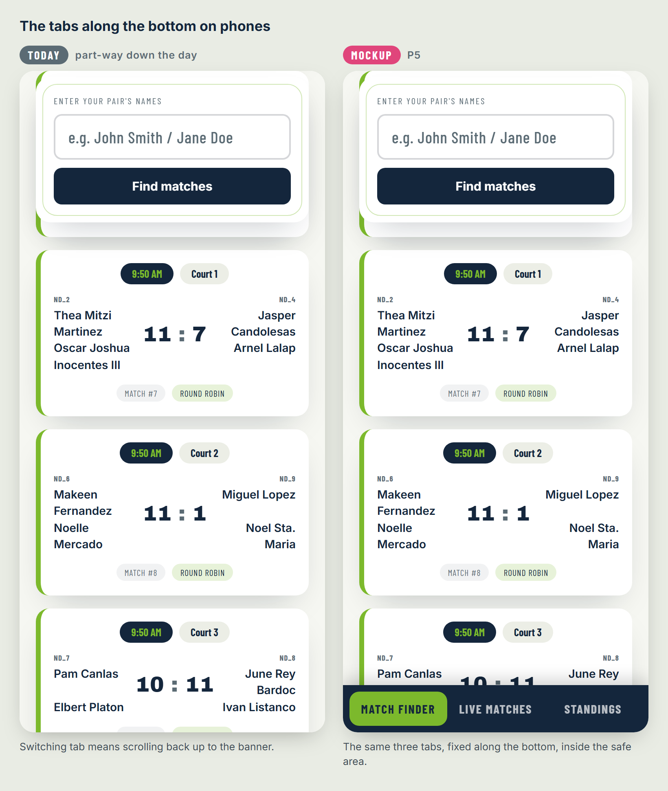
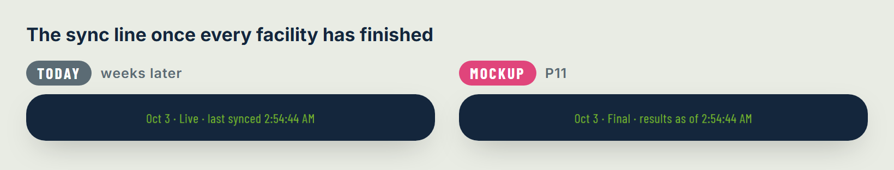

# Spec — Tournament Hub player experience

> **Status: not started — proposals for the owner to choose from.** Written
> 2026-10-10 against `lib/v1` and the three event-site templates in
> `sage-match-control.github.io` as of commit `d68acf8`; P9–P17 added
> 2026-10-25 against commit `d7ed8ed`. Each proposal in §4–§20
> stands alone: it can be kept or dropped without changing the others, except
> where its **Depends on** line says so. §3 is the table to mark up. Nothing
> here is built.

Make the two things a player opens the [Tournament Hub](../../features/tournament-hub.md)
for, *where and when do I play next?* and *where do we stand?*, quicker on a phone.
Nothing moves off the page and no new sections are added. The Hub keeps its three
tabs (four at a team event).

---

## 1. Why

On 2026-10-10 the Hub was compared with another organiser's player portal for
a one-day event (Purple Pickle XP, "Powered by Qourts"). It is one 1.8 MB HTML file
reading a Supabase table every 15 seconds. That portal does three things better on
a phone:

- It opens on the player's **next match** (court and time in large type) once the
  player has picked their name, on every later visit too.
- Its section tabs are a **bar along the bottom** of the screen, always one tap
  away.
- The first screen is **the task**, not the event's banner.

Behind those it has more sections than it needs: eight on a computer, five plus a
menu on a phone, several overlapping. It also has a sign-in-style welcome
screen in front of everything, and it shows organiser jargon (`P001`, `A-A1`,
`PE · PC · PQ`). The Hub is already simpler, and these proposals keep it so.
They take the three things above and leave the rest (§21).

### 1.1 What the Hub does today, measured

The standard template on the Piggleball fixture, mid-day, on a 375 × 812 phone
screen (the harness's `phone` size):

| | Top of it, from the top of the page |
| --- | --- |
| The tabs (Match Finder, Live Matches, Standings) | 346 px |
| The search box | 535 px |
| A pair's results, after a search | 755 px: 57 px of it on the first screen |

- **A search shows nothing new on the first screen.** Picking a suggestion, tapping
  **Find matches** or pressing Enter runs the search, and the page stays where it
  is. The results begin 57 px above the bottom edge, so a player sees the box
  change and has to scroll to find out whether anything happened.
- **Find matches leaves the suggestions open** over the results: the page closes
  them on a click outside `.autocomplete`, and the button is inside it. On a
  phone, Enter leaves the keyboard up as well.
- **The last search comes back on reload** (`<event>.search` in the browser's
  storage), with the same layout: the results are below the first screen again.
- **A pair's results list every match** in schedule order, with a **Next Up** pill on
  one ticket. The player scans the list for it.
- **Each side of a ticket starts with its team code** (`ND_5`, `ND_QF_4`), in
  Control Center's small muted style, above the names.

### 1.2 A second comparison: Dinktator, 2026-10-25

On 2026-10-25 the Hub was compared with Dinktator's spectator pages for Paddle Up! vs
Bangers 4.0 (`pvo.dinktator.club/t/pvo`), a two-club, two-day event with the same
shape as a dual meet. Pages are drawn on the server and updated over a WebSocket.
Umpires score every match from their own devices. It has five pages, each with its
own address: Courts, Standings, Bracket, Schedule, and a page per court. Their
standings work better on a phone:

- **They open on a division.** A dropdown picks one, and the first is chosen already.
- **They explain themselves.** The rule for who advances is printed at the cut line.
  A pair placed by a tiebreak says so ("Tied on win–loss — placed by quotient"). A
  pair's row opens its games and its quotient worked out (`51 ÷ 31 = 1.645`). A line
  counts the division's games ("50 of 50 games final").
- **A pool has a cross-club grid.** One club's pairs down the side, the other's across,
  every score in its cell.
- **A finished division shows its podium**: champions, runners-up and bronze, and the
  final's score.

Their pages show no club-against-club total anywhere, and they lead with pair codes
(`PU-HMD-04`) before names. The Hub does both of these better already.

Measured on the Hub, on a 375 × 812 phone screen: Piggleball (standard, engine) and
PNF × BUP (dual meet, built before the engine, whose Standings the engine's dual-meet
Standings follow), both on 2026-10-25:

- **Standings open empty on a phone.** The phone's category search starts blank:
  "Search and select a category above to view its standings."
- **A dual meet's Standings are one long column.** Every category is stacked under the
  club bar (`dualMeetStandingsHTML`'s phone branch). At PNF × BUP that is 7 categories
  and about 6,300 px, with no way to jump to one.
- **The sync line says *Live* for good.** `apps/hub.js` writes "*day* · Live · last
  synced *time*" whenever a snapshot loads. Piggleball reads "Oct 3 · Live · last
  synced 8:25:50 AM" three weeks later.
- **A tab has no address.** Switching tab changes the page but not its URL (the
  view is kept in the browser's storage only), so a QR code or a shared link can't
  open on Standings.
- **The row colours aren't explained.** A table row is green when the pair has more
  wins than losses and pink otherwise, a level record such as 2–2 included
  (`standingRowClass`, `views/ticket.js`). A reader takes green for *advancing*,
  which it isn't.
- **The counts call pairs teams.** Match Finder's first screen reads "126 Matches ·
  56 Teams · 7 Divisions" at PNF × BUP, where the teams are the two clubs and the
  56 are pairs.
- **A dual meet's club score is only in Standings.** The club bar (`clubSummaryHTML`)
  is drawn at the top of Standings and nowhere else.

P9–P17 take these. §21 lists what is not taken from Dinktator.

## 2. Scope

- **The engine Hub only:** `lib/v1` (`apps/hub.js`, `views/finder.js`,
  `views/ticket.js`, `views/standings.js` and their CSS) and the three templates'
  `index.html`, so every event made from a template from then on. Every event
  page built so far, under `events/` and `events/archives/`, is self-contained
  and frozen and imports nothing from `lib/v1`. They do not change.
- **Control Center does not change.** It shares the finder and the ticket, so every
  change it should not get is an option the Hub passes, off by default
  ([site engine](../../technical/site-engine.md#changing-the-engine): "add an
  option rather than a flag").
- **The schedule board, scorer page and desk page do not change.**
- No new data. Every proposal reads what the snapshot and `events.json` already
  carry, except P7's one optional setting.

## 3. The proposals, to mark up

| # | Proposal | Size | Recommendation | Keep? |
| --- | --- | --- | --- | --- |
| [P1](#4-p1-show-the-results-after-a-search) | Show the results after a search | Small | Keep | |
| [P2](#5-p2-a-shorter-banner-on-phones) | A shorter banner on phones | Small | Keep | |
| [P3](#6-p3-your-next-match-card) | "Your next match" card | Medium | Keep | |
| [P4](#7-p4-names-not-team-codes-on-the-hubs-tickets) | Names, not team codes, on the Hub's tickets | Small | Keep | |
| [P5](#8-p5-the-tabs-along-the-bottom-on-phones) | The tabs along the bottom on phones | Small–medium | Try on a real phone first | |
| [P6](#9-p6-say-when-standings-are-provisional) | Say when standings are provisional | Small | Keep | |
| [P7](#10-p7-a-rules-link) | A rules link | Small | Keep if organisers supply rules | |
| [P8](#11-p8-follow-more-than-one-pair) | Follow more than one pair | Medium | Drop for now | |
| [P9](#12-p9-a-tabs-own-address) | A tab's own address | Small | Keep | |
| [P10](#13-p10-standings-open-on-a-category-on-phones) | Standings open on a category on phones | Small | Keep | |
| [P11](#14-p11-say-final-once-the-day-is-over) | Say *Final* once the day is over | Small | Keep | |
| [P12](#15-p12-a-podium-on-a-finished-category) | A podium on a finished category | Small–medium | Keep | |
| [P13](#16-p13-explain-the-colours-and-the-ties) | Explain the colours and the ties | Small | Keep | |
| [P14](#17-p14-a-standings-row-opens-that-pairs-matches) | A Standings row opens that pair's matches | Small | Keep | |
| [P15](#18-p15-a-dual-meets-club-score-first-and-pairs-not-teams) | A dual meet's club score first, and *Pairs*, not *Teams* | Small | Keep | |
| [P16](#19-p16-jump-to-a-category-in-a-dual-meets-standings) | Jump to a category in a dual meet's Standings | Small | Keep | |
| [P17](#20-p17-a-cross-club-grid-per-category) | A cross-club grid per category | Medium | Keep | |

P1–P4 together give the Hub Purple Pickle XP's best feature (open, see your next
match) without its welcome screen. They are the core of this spec. P5–P8 are
independent extras. P9–P17 come from the second comparison (§1.2). P10–P14 make
Standings answer *where do we stand?* on a phone, and P15–P17 do the same for a
dual meet.

**The pictures.** Each proposal that changes what the page shows has a picture:
the page today beside a mockup of the proposal, or two mockups for a change that
happens in two steps. They are the engine's own template pages, served by the
site's comparison harness on its fixture data with the clock held at 1 PM on a
375 × 812 phone screen, and photographed after the proposal's new elements were
drawn into the page. So everything outside the change is the real page.
The new elements are a sketch of the proposal, not its final styling, and every
mockup is labelled **Mockup**. P7, P8 and P9 have none: P7 is one link, P8 is
dropped and P9 changes only the address.

---

## 4. P1. Show the results after a search

**Problem.** §1.1: a search changes nothing on a phone's first screen, the
suggestions can stay open over the results, and the keyboard stays up.

**Proposal.** When a person runs a search (a suggestion picked, **Find matches**,
Enter, or a team chip at a team event):

1. Close the suggestions.
2. On a phone (below 900 px, where the search box is already pinned to the top
   of the screen), take the focus out of the box so the keyboard closes.
3. Scroll the page so the results' first line sits just below the pinned search
   box. The scroll is instant under *reduce motion*, smooth otherwise.

Nothing scrolls when the Hub redraws the same results for new data (every push
and every poll), when the box is cleared, or on a computer screen. A
**restored** search on page load is P3's open decision D3.

P1, P3 and P4 together, as a player sees them after one search.

**Where.** `views/finder.js`: a new `createFinder` option, `revealResults`
(default `false`), applied in the event handlers rather than in `run()`, because
`refresh()` calls `run()` on every data update. `apps/hub.js` passes `true`.
The team event's finder (`views/teams.js`, the finder's `delegate`) goes through
the same handlers and gets it too. Closing the suggestions on **Find matches**
is a fix and applies everywhere, Control Center included.

**Tests.** A `finder.test.mjs` case per trigger (what scrolls, and that a refresh
does not). The harness's phone `finder-search` cases change (accepted
differences, each with its reconciliations row).

**Open decisions.** None.

## 5. P2. A shorter banner on phones

**Problem.** The banner (event logo, tagline, date and venue, title, headline,
"Find your pair's full match schedule…", tabs, divider, sync line) fills the
first 500 px of a phone screen, so the search box starts at 535 px.

**Proposal.** On a phone, once a day has loaded, drop the explanatory subtitle and
the divider and tighten the rest. The logos, the date and venue line and the
title stay, smaller. The target is the search box's top **within the first
350 px**, so after P1 the first result ticket is on the first screen. The banner
before a day loads (the day picker, a "Loading…" or error message) and every
computer-sized screen stay as they are.

The mockup is D1 as proposed, and goes further than the target: 213 px, against 350.

**Where.** `css/hub.css`, under a phone media query and a class `apps/hub.js`
puts on `.hero` once the tabs show (new class names only). Each template's `THEME`
block is untouched, so an event's look carries over.

**Tests.** Every phone Hub case's screenshot changes: one accepted difference per
template.

**Open decisions.**

- **D1.** How much of the banner stays: the title at a smaller size (proposed), or
  only the logos and title, or the whole banner collapsing to one line as the
  page scrolls (more work, and it moves under the reader's thumb).

## 6. P3. "Your next match" card

**Problem.** A pair's results are every match of the day. The one the player
wants is marked by a small **Next Up** pill somewhere in the list.

**Proposal.** Above the ticket list, one card that answers the question. Its
state follows the rules the tickets already use (domain `matches.js`,
`series.js`, `byes.js`):

| State | When | The card shows |
| --- | --- | --- |
| **Playing now** | One of the pair's matches is on a court (`court` is set) | *Playing now · Court 3*, the opponent, the score if one is in |
| **Next match** | Otherwise, the first match not played, not live, not a game that won't be needed and not a BYE (the **Next Up** ticket's rule) | *Next match · 10:15 AM · Court 1*, the opponent's names, the round (*Round robin*, *Semifinal*…) |
| **Waiting on a result** | The next match is a playoff slot whose opponent isn't decided | As *Next match*, with the opponent reading *To be decided* |
| **All done** | Every match played | *All 7 matches played*, the pair's wins and losses |

The court in *Next match* is the scheduled `CourtAssignment`. When the match is
called to a court it becomes *Playing now* with that court.

The list underneath stays as it is, **Next Up** pill included. The card is only
the summary.

With P1, a search lands on this card. With the saved search (§1.1), so does a
returning visit, which is what Purple Pickle XP's "My Games" gives its players,
with no welcome screen and no extra step.

The picture under P1 shows the card in the *Next match* state.

**Where.** `views/finder.js`: a new export, `nextMatchCardHTML(team, matches,
model)`, called from `pairResultsHTML`, and its styles in `css/finder.css`. It
is a pure function, unit-tested on the fixtures' `pre`, `mid` and `final`
states. Control Center does not show it (an option, as in §2).

**Depends on.** Nothing; it is most useful with P1 and P2.

**Open decisions.**

- **D2.** A team event: the same card for the team's next **matchup** (both time
  slots and courts) and for a player's next match within it, or standard and
  dual-meet events first and the team card later (proposed).
- **D3.** On a page load with a saved search, scroll to the card (as the other
  portal opens on its *My Games* screen) or leave the page at the top (today).
  Scrolling is proposed, but only when the saved tab is Match Finder.

## 7. P4. Names, not team codes, on the Hub's tickets

**Problem.** Every ticket side begins with the pair's workbook code (`ND_5`,
`ND_QF_4`). It means nothing to a player, and the round is already on the ticket
as its own pill. The team event's Hub already hides its codes (its
`teamLetters: false`).

**Proposal.** A ticket option, `showCodes` (default `true`), that the Hub sets to
`false`. A side with a player's name shows the names alone, with the **You**
badge beside the first name. A side with no names yet (an undecided playoff
slot) keeps the code, since nothing else on the ticket says which slot it
is. Control Center keeps its codes. Standings keep the code for a round-robin
pair whose names aren't in the sheet yet, as the Hub's page describes.

The picture under P1 shows tickets without codes, the **You** badge after the first name.

**Where.** `views/ticket.js`, `css/ticket.css`, the option passed through
`createFinder`'s `ticket` and `apps/hub.js`.

**Tests.** `ticket.test.mjs` cases for both values and the no-names side. Harness
accepted differences on the Hub's finder cases.

**Open decisions.** None.

## 8. P5. The tabs along the bottom on phones

**Problem.** After scrolling down a long list (the day's matches, a category's
standings), switching tab means scrolling back up to the banner.

**Proposal.** On a phone, the tab row becomes a bar fixed to the bottom of the
screen, inside the phone's safe area (above the home indicator). It has the same
tabs and labels, text only. It shows when the tabs show today, once a day has
loaded. The page gains bottom padding the bar's height, so the footer is never
under it. Computer screens are unchanged.

**Where.** `css/hub.css` (new rules for the existing `.view-tabs` under a phone
query, plus a new class so nothing a page uses is renamed). Each template's
viewport tag adds `viewport-fit=cover`, which the safe-area inset needs.

**Cost.** The pinned search box at the top and the bar at the bottom together
take about 200 px of an 812 px screen while Match Finder is open. iOS Safari's
own bottom toolbar moves as the page scrolls, and a fixed bar has to be seen
on a real iPhone and Android phone before an event, not only in the
harness.

**Open decisions.**

- **D4.** Keep the tabs in the banner as well (two ways to the same thing), or
  move them (proposed, with P2).
- **D5.** Icons above the labels, as Purple Pickle XP has: proposed **no**,
  since it means an icon set in every shell for little gain.

## 9. P6. Say when standings are provisional

**Problem.** The Hub ranks a round-robin table by wins, then head-to-head, then
quotient. The workbook picks who advances by wins, then quotient, so on a
head-to-head tie the two can differ. The [Hub's page](../../features/tournament-hub.md)
says so. The Hub itself does not, and a table mid-round-robin reads as final.

**Proposal.** Text only; the Hub never works out who would advance.

- Each round-robin table's header gets a status line: *In progress · 6 of 10
  matches played* (the played rule of `matches.js`, BYEs left out), then *Round
  robin complete*.
- One line under the tables: *Ranked by wins, head-to-head, then quotient. The
  organisers confirm who advances.*
- A playoff slot still reads **TBD** until the workbook fills it (today's
  behaviour), so the bracket is never a projection.

The picture shows P6 and P13 together, on a finished bracket. Part-way through, the
status line reads *In progress · 4 of 6 matches played*.

**Where.** `views/standings.js`, `css/standings.css`. Control Center's Standings
use the same builder and get it too, which is proposed: operators answer this
question at the desk.

**Tests.** `standings.test.mjs` for the counts on `pre`, `mid` and `final`. Harness
accepted differences on every Standings case.

**Open decisions.**

- **D6.** Team events: their Standings are ranked by the organiser's
  tiebreakers in the workbook's order and seeded by hand, so only the status line
  applies. Include it (proposed) or leave team Standings alone.

## 10. P7. A rules link

**Problem.** An organiser's rules (scoring, time limits, tiebreakers) are handed
out on paper or in a group chat, and the Hub has nowhere to point at them.

**Proposal.** An optional `mountHub` setting, `rulesUrl` (default `''`, meaning no
link). When set, a **Rules** link shows under the tabs and in the footer and opens
the file in a new tab. The rules file goes in the event's own folder
(`events/<event-key>/assets/rules.pdf`), like its QR image. The Hub does not
render the rules or give them a tab.

**Where.** `apps/hub.js` (a new known setting: an unknown setting is already an
error, so this is the compatible way to add one), the templates' markup and the
instantiation runbook (`_templates/CLAUDE.md` §2), as an optional step.

**Open decisions.**

- **D7.** A shell setting (proposed: the file is in the site repo, beside the page)
  or a `display.rulesUrl` in `events.json` (changeable without touching the site
  repo, but a site file named from the data repo).

## 11. P8. Follow more than one pair

**Problem.** A player entered in two categories, or a parent with two children
playing, searches each time. The Hub remembers one search.

**Proposal.** Match Finder keeps up to four followed pairs on the device, as
chips above the results, each opening its results and P3 card.

**Recommendation: drop for now.** It is Purple Pickle XP's most complex screen.
It adds a list to manage (add, remove, a limit) and the saved-search
format changes. Most players are in one category on a day. Revisit if
organisers report multi-category players asking for it.

## 12. P9. A tab's own address

**Problem.** §1.2: a tab has no URL of its own. A QR code at the venue, the Hub board
or a link sent to a group chat always opens on Match Finder (or on whatever tab that
phone last had open), never on Standings.

**Proposal.** Each tab gets an address fragment: `#finder`, `#live`, `#standings`,
and `#teams` at a team event. A tab tap replaces the fragment (`history.replaceState`,
so Back still leaves the page rather than stepping through tabs). On load, a known
fragment wins over the saved view. An unknown fragment, or a tab the event doesn't
have (`#teams` at a standard event), is ignored and the saved view applies as today.

**Where.** `apps/hub.js`, beside `saveView` and `loadSavedView`. Nothing in the
shells changes.

**Tests.** A `hub` case per fragment, and one that an unknown fragment falls back to
the saved view.

**Open decisions.**

- **D8.** A tab tap replaces the fragment (proposed) or adds a history entry, so Back
  returns to the previous tab.

## 13. P10. Standings open on a category on phones

**Problem.** §1.2: on a phone a standard event's Standings start empty until a
category is searched for, even at an event with three.

**Proposal.** On a phone, Standings open on a category:

1. the category of the pair in the saved search, when there is one;
2. otherwise the first category in the event's category order.

The search box shows the chosen category and works as today. A category the reader
picks is kept as today (`selectCategory`).

**Where.** `views/standings.js`: a `createStandings` option, `openOnCategory` (default
`false`), with `apps/hub.js` passing `true` and a way to read the saved search's
category. Control Center keeps its own behaviour.

**Tests.** `standings.test.mjs` for both rules and for an event with no categories yet.
Harness accepted differences on the phone Standings cases.

**Open decisions.**

- **D9.** At an event with few categories (four or fewer), chips on phones as on a
  computer, instead of the search. Proposed **no**: one control per screen size is
  simpler, and P10 removes the empty first screen either way.

## 14. P11. Say *Final* once the day is over

**Problem.** §1.2: the sync line reads *Live* whenever a snapshot loads, weeks after
the event too.

**Proposal.** Once every facility in the day's snapshot has a `completedAt` (the stamp
`facilityCompletion` puts on a facility when its last match is played), the line reads
"*day* · Final · results as of *time*", the time being the snapshot's `generatedAt`,
since a score corrected after the last match still counts. Until then it reads as
today. The *Live (partial)* line for a facility that couldn't be reached is unchanged.

The time is the fixture snapshot's own `generatedAt`, a resync after the day.

**Where.** `apps/hub.js`, where `statusEl` is written.

**Tests.** A `hub` case on the `final` fixture state, one on `mid`.

**Open decisions.**

- **D10.** A day that ends with a facility short of `completedAt` (a match cancelled
  and never scored) keeps reading *Live*. Proposed: accept that, rather than also
  using the day's date, which `events.json` carries only as the label.

## 15. P12. A podium on a finished category

**Problem.** A category's result is the Final's row in its bracket. Nothing on the Hub
says who won.

**Proposal.** Once a category's Final and Bronze are both scored, its Standings card
opens with a podium: gold, silver and bronze, with the names, and under gold
"Beat *names* *score* in the final". The rules are Control Center's Awards tab's,
`buildPodiums(model)` in `domain/awards.js`, so a podium on the Hub never disagrees
with the one the organisers export. The bracket stays underneath unchanged.

**Where.** `views/standings.js`: a new export, `podiumHTML(podium)`, and a
`createStandings` option, `podium` (default `false`), that `apps/hub.js` sets.
Control Center has its Awards tab and keeps the option off. Styles in
`css/standings.css`.

**Tests.** `standings.test.mjs` on the `final` state (a podium) and on `mid` (none).
Harness accepted differences on the final-state Standings cases.

**Open decisions.**

- **D11.** Team events, through `buildTeamPodium`, now or later. Proposed later, with
  P3's team card (D2).

## 16. P13. Explain the colours and the ties

**Problem.** §1.2: green and pink rows read as *advancing* and *out*. They mean a
winning record and anything else. And where pairs are level on wins, nothing says what
put one above the other.

**Proposal.** Text only.

- Under each round-robin table, with P6's line: *Green: more wins than losses.
  Pink: as many losses as wins, or more.*
- A pair placed above another level on wins gets a short note under its names, from
  the rule of the Hub's order that separated them. Among the pairs level on wins the
  Hub counts each one's wins against the others in that group, then compares quotients
  (`rankStandings`, `domain/standings.js`). So the note is *Level on wins, ahead on
  head-to-head* or *Level on wins and head-to-head, ahead on quotient*.

Two pairs level in a standard bracket have played each other, so head-to-head settles
it. Three or more can beat each other in a circle, as in the picture, and then the
quotient does. In a dual meet one club's pairs never meet, so a tie there is always
settled by quotient.

The picture under P6 shows both parts: three pairs on two wins, each having beaten one
of the others, placed by quotient.

**Where.** `domain/standings.js`: `rankStandings` also reports, for each pair, which
rule put it above the next one (a new export beside it, so its callers don't change).
`views/standings.js`'s row template shows the note. Control Center gets it too, as
with P6.

**Depends on.** P6 for the line the legend joins. Without P6 the legend is a line of
its own.

**Tests.** `standings.test.mjs` with a head-to-head split and a circular three-way
split (Pickle for Sight's Novice Mixed Doubles, Bracket 2) on the fixtures. Harness
accepted differences on every Standings case.

**Open decisions.**

- **D12.** Keep the colours with a legend (proposed), or drop them, since a legend is
  needed only because they look like something else.

## 17. P14. A Standings row opens that pair's matches

**Problem.** A table shows W, L and Q but not the games behind them. A pair checking
its place has to switch to Match Finder and type its names.

**Proposal.** Tapping a pair's row runs Match Finder's search for that pair: the tab
switches and, with P1 and P3, the page lands on its next-match card and its matches.
Each row ends with a **›** so it reads as something to tap. A row with no names yet
(an unseeded playoff slot) has none and does nothing.

The pair's results gain one line: its round-robin record and quotient worked out
(*Round robin: 4 won · 0 lost · quotient 44 ÷ 7 = 6.2857*). It counts round-robin
matches only, as Standings does, so the two always agree.

**Where.** `views/standings.js` (a row's `data-team` and a click handler calling a
`createStandings` option, `onPairSelect`, default none) and `apps/hub.js`, which runs
the search as a suggestion pick would. The quotient line is in `views/finder.js`.

**Depends on.** P1, for the search to land on the results.

**Tests.** A `standings.test.mjs` case for the handler, a `finder.test.mjs` case for the
quotient line. Harness: a phone case tapping a row.

**Open decisions.** None.

## 18. P15. A dual meet's club score first, and *Pairs*, not *Teams*

**Problem.** §1.2: at a dual meet the question everyone asks, *which club is
winning?*, is answered only at the top of Standings. And Match Finder's first screen
counts pairs as *Teams*, at every standard and dual-meet event.

**Proposal.**

- At a dual meet, the club bar (`clubSummaryHTML`: each club's round-robin wins, with
  the leader picked out) is also drawn at the top of Match Finder's first screen, above
  the counts. It is the same bar, so it reads the same in both places.
- The middle count reads *Pairs*. The rule that counts them (a code ending in a bare
  number) is unchanged.

**Where.** `views/finder.js` (`introHTML`), importing `clubSummaryHTML` from
`views/standings.js`, which needs its club grouping, now inside
`dualMeetStandingsHTML`, as an export of its own. Per the engine rules the finder
starts using the new export one push after the export lands. The label change reaches
Control Center's Match Finder too, which is proposed: *Pairs* is right there as well.

**Tests.** `finder.test.mjs` for the bar at a dual meet and its absence at a standard
event, and the label. Harness accepted differences on every Match Finder first screen.

**Open decisions.** None.

## 19. P16. Jump to a category in a dual meet's Standings

**Problem.** §1.2: a dual meet's Standings on a phone are every category in one
column, about 6,300 px at PNF × BUP's seven.

**Proposal.** A row of category chips under the club bar, one per category in the
category order (*LI WD*, *LI MD*…, the short labels the schedule board already uses).
A tap scrolls to that category's card. It is a jump, not a filter: the page stays whole
and can still be scrolled through. The club bar and chips stay pinned at the top while
Standings scroll, as the club bar already is at PNF × BUP.

**Where.** `views/standings.js` (`dualMeetStandingsHTML`'s phone branch, and an id on
each category column) and `css/standings.css`. The computer layout, a grid of columns,
is unchanged.

**Tests.** `standings.test.mjs` for the chips' order and targets. Harness accepted
differences on the dual-meet phone Standings case.

**Open decisions.**

- **D13.** Jump (proposed), or a filter to one category as a standard event's phone
  search does (shorter, but the whole picture of both clubs goes).

## 20. P17. A cross-club grid per category

**Problem.** A dual meet's category card has a table per club (W, L, Q) and the
cross-club Bronze and Final. The round-robin games between the two clubs, which decide
both tables, aren't shown.

**Proposal.** Under each category's two club tables, a grid: one club's pairs down the
side, the other's across, each cell that match's score read row pair first, marked won
or lost, and an empty cell where the two didn't meet. Each row ends with its pair's W–L
and points. It is drawn from the day's matches (`model.matches`, round-robin stage
only), so it needs no new data. On a phone it scrolls sideways inside its card, with
the row names pinned, rather than shrinking the cells.

The grid is shown open; on a phone D14 proposes it folded.

**Where.** `views/standings.js`: a new export, `crossClubGridHTML(cat, perClubRows,
model)`, called from `categoryColumnHTML`, and styles in `css/standings.css`. Control
Center gets it too (proposed): it is the operators' quickest check of a disputed score.

**Depends on.** Nothing. Most useful with P16.

**Tests.** `standings.test.mjs` on the PNF × BUP fixture
(`_tests/fixtures/pnf-x-bup-dual-meet/`): every played pairing in its cell, a missing
pairing empty, the row-first reading. Harness accepted differences on every dual-meet
Standings case.

**Open decisions.**

- **D14.** The grid open (proposed on a computer) or folded under a *Head-to-head*
  heading (proposed on a phone, where it doubles the card's height).

---

## 21. Not taken from the other portals

### 21.1 From Purple Pickle XP (2026-10-10)

| Their feature | Why not |
| --- | --- |
| A welcome screen asking "player or spectator" before anything shows | An extra step for every spectator. P3 gives players the same result after one search |
| The event poster as the home screen | The banner already carries the event's identity; P2 makes it smaller, not larger |
| Eight sections (Home, Overview, Schedule, Standings, Live Courts, Championship, My Matches, Rules) | They overlap. The Hub's three tabs cover the same ground |
| A venue TV view inside the player portal | The [schedule board](../../features/schedule-board.md) is a separate, unlisted page on purpose |
| A qualification projection ("Live projection") | The workbook decides who advances; P6 says so instead of guessing |
| Polling a database row every 15 s | The Hub's live push is faster and archives every publish |
| A 1.8 MB page with its images inlined | The Hub's shell loads the engine's modules and the event's own images as separate files, and nothing here adds an image |

### 21.2 From Dinktator (2026-10-25)

| Their feature | Why not |
| --- | --- |
| A page per court (umpire, up next, the rest of the court's day) | A new page, outside this spec's scope (§2). The [schedule board](../../features/schedule-board.md)'s court filter covers part of it. A court view for a QR code at each court would be a spec of its own |
| A schedule grid that becomes stacked cards on a phone | The schedule board doesn't change here (§2). Worth its own change to the board: at PNF × BUP's nine courts a phone shows two at a time and cuts long names short |
| Players signing in, so their own matches are marked and the phone buzzes when they're called | A sign-in step for every player. P3 and the saved search give the same *your match* without one, and iOS Safari has no vibration |
| Pair codes before names (`PU-HMD-04`) | P4 goes the other way |
| Overlapping initials circles for each pair | No photos to show, and the second circle clips the first one's initials |
| An umpire's name on each court, PAUSED / NEXT states and a call-to-court forfeit clock | The workbook carries none of it. Calling a match to a court belongs to Control Center ([Court Control](control-center-court-control-spec.md)) |
| A sponsor's logo on every court card | Organiser artwork per court that no event has asked for. The event's own banner carries its partners |
| Five separate pages behind a menu | P9 gives each tab an address without splitting the Hub |

## 22. Building it

- **Engine rules apply** ([site engine](../../technical/site-engine.md)): only
  `lib/v1` is edited, compatibly (new options, exports and classes, nothing
  removed or renamed), and a module only starts using another's new export in a
  later push.
- **Each proposal is its own push**, in the order of §3. Each runs
  `npm run verify` and adds its accepted differences to
  `_tests/engine/accepted.mjs`, each with a new row in the site engine spec's
  reconciliations table (§12).
- **Not within three days of an event**, as for any push to the site's `main`.
- **Docs, with each one built:** [Tournament Hub](../../features/tournament-hub.md)
  (Match Finder, Standings), [site engine](../../technical/site-engine.md) for new
  options and settings, the runbook for P7, and this spec's status line and a
  divergences section once anything departs from what is written here.

## 23. Open decisions, in one place

| # | Proposal | Decision | Proposed |
| --- | --- | --- | --- |
| D1 | P2 | How much of the banner stays on a phone | Logos, date and venue, title (smaller) |
| D2 | P3 | Team events' next-matchup card now or later | Later |
| D3 | P3 | Scroll to the card when a saved search is restored on load | Yes, when the saved tab is Match Finder |
| D4 | P5 | Tabs in the banner as well as the bottom bar | Move them |
| D5 | P5 | Icons in the bottom bar | No |
| D6 | P6 | Team Standings get the status line | Yes |
| D7 | P7 | Rules link as a shell setting or in `events.json` | Shell setting |
| D8 | P9 | A tab tap replaces the address fragment or adds a history entry | Replace |
| D9 | P10 | Category chips instead of the search on phones at small events | No |
| D10 | P11 | A day with a facility never marked complete keeps reading *Live* | Accept it |
| D11 | P12 | Team events' podium now or later | Later, with D2 |
| D12 | P13 | Keep the row colours with a legend, or drop them | Keep, with a legend |
| D13 | P16 | Category chips jump to a category or filter to it | Jump |
| D14 | P17 | The cross-club grid open or folded | Open on a computer, folded on a phone |

---
**Features:** [Tournament Hub](../../features/tournament-hub.md) · **Technical:** [site engine](../../technical/site-engine.md)
